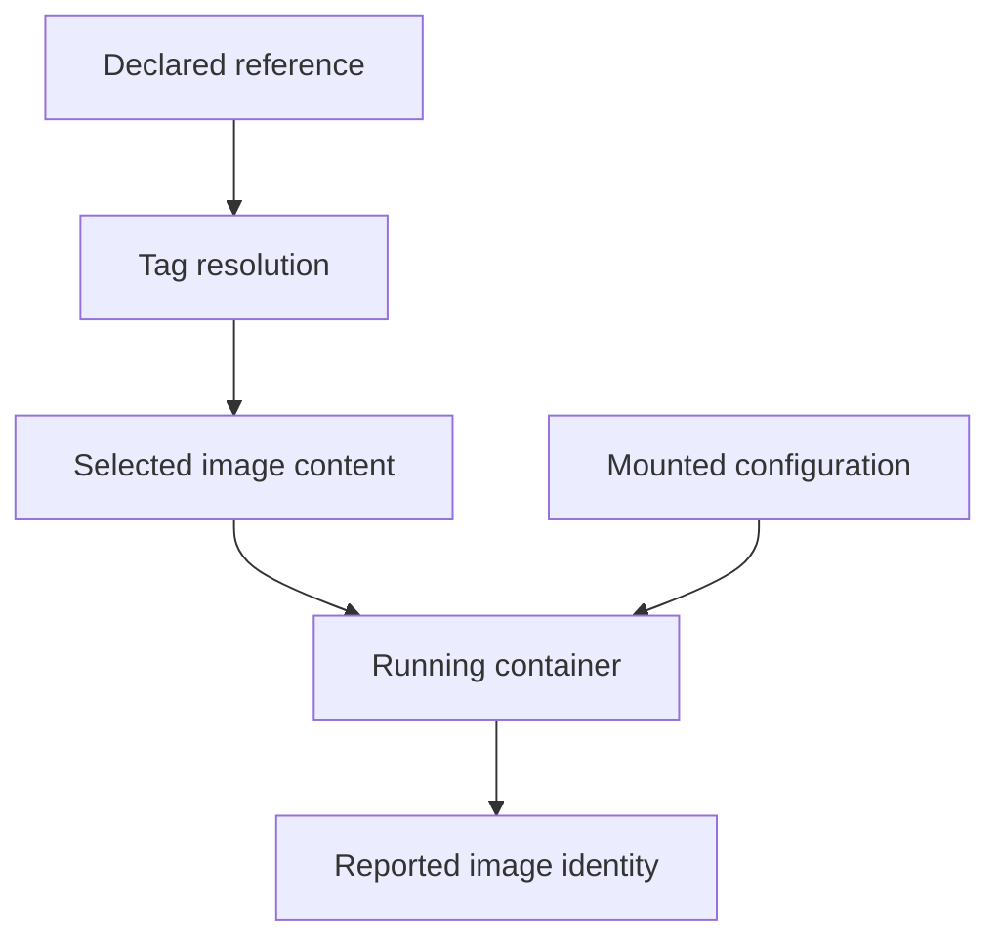

# Layers, Tags And Digests

Two `probe` Pods can show the same image tag while using different downloaded content. To explain that difference, separate the image name from the content it identifies and separate the image filesystem from files changed during execution.

## Learning objectives

- Explain image layers and immutable digests.
- Distinguish tags from exact image identity.
- Trace image retrieval and registry authentication.

## Before you start

This chapter is standalone reading material; no running cluster or installed tools are required. A Pod is the Kubernetes unit for running one or more containers, and a namespace groups namespaced objects. Treat the worked configurations as teaching examples rather than recorded observations from a provisioned environment.

## Responsible components and behavior

The `scout` image contains application files and runtime dependencies. An image is a packaged filesystem and execution configuration used to create containers. Images commonly use reusable filesystem layers. Multiple images can share unchanged layers rather than storing every file again.

A running container adds a writable layer above its image data. Changes there do not rewrite the published image. Replacing the container does not make that writable layer a reliable store of application data. A volume provides a separate storage lifecycle when files need different persistence behavior.

A registry stores and distributes container image artifacts. An image reference identifies a registry, repository and tag or digest. A tag is a human-readable reference such as `v2`; the publisher can move it to a different artifact. A digest identifies content through a cryptographic hash. Referring to a digest makes artifact selection more precise than relying on a mutable tag.

An image index can describe variants for several processor architectures. A node needs a compatible variant for its architecture and operating system. A correct repository name and valid credentials cannot fix an artifact that lacks a compatible platform variant.

Tags can support a useful naming convention, but a naming convention is not an immutability guarantee. A release labeled `stable` can change without a visible change to the workload's image string. Recording the built artifact's digest makes review and incident investigation easier.

Suppose a workload restarted yesterday and received different application behavior while its tag stayed unchanged. A moved tag and a different pulled artifact are possible explanations. Compare the actual artifact identity before assuming the process configuration changed.

## Understanding Layer Reuse And Writable State

Suppose version one and version two of `scout` share the same operating system files but differ in application code. Reusing unchanged image layers can reduce transfer and storage, while the changed application layer identifies part of the new content. The final image manifest and digest identify the assembled artifact, not only the last source file edited.

During execution, a writable container layer records filesystem changes above the image. Creating a temporary report there does not publish a new registry image. Another container started from the original image does not receive the report automatically. This distinction is essential when predicting replacement and scaling behavior.

A volume mounted over a path can also change what files the process sees. The image may contain defaults at that path, while a mount presents different content. Effective runtime files therefore depend on both artifact content and the Pod's mounts. Looking only at the image is not enough to diagnose every configuration difference.

## Reference Names And Content Identity

A tag such as `v2` expresses a publisher's naming convention. It can be treated as immutable by policy, but the reference mechanism itself allows movement. A digest identifies content and supports a precise link between testing, release and incident evidence. If the content changes, its content-addressed identity changes.

Multi-platform images commonly use an index that refers to platform-specific image manifests. An index digest can identify the collection, while the runtime selects the compatible variant for its node. This explains why platform support matters even when the top-level image reference is valid.

For a changed-behavior incident, compare the declared reference, the artifact actually used and runtime mounts or settings. The same tag with a different pulled digest is one possible cause; the same digest with different configuration is another. Separate these hypotheses rather than treating every application difference as a rebuilt image.

## Work through the decision

The example declares `docker.io/library/python:3.13-alpine`. Its components identify a registry, an image repository and a tag. A tag is a publisher-controlled name. A digest is a cryptographic content identifier. When a tag moves, the reference can stay the same while the selected content changes.

The runtime reports its realized image identity in container status after startup. That field is runtime evidence, not a replacement for the image's provenance or the application's configuration. A mounted ConfigMap can change visible files without rebuilding the image. Investigating changed behavior therefore needs both content identity and runtime inputs.

Running behavior depends on selected image content and runtime inputs, while a tag alone describes only a reference.

You can now compare selection names with realized content. Matching image identities narrow the investigation but leave configuration, mounts and application state as separate possible causes of changed behavior.

## Common pitfalls

> [!WARNING]
> Tags can move. Container filesystem changes do not update the registry image, and a container's writable layer is not durable application storage.
