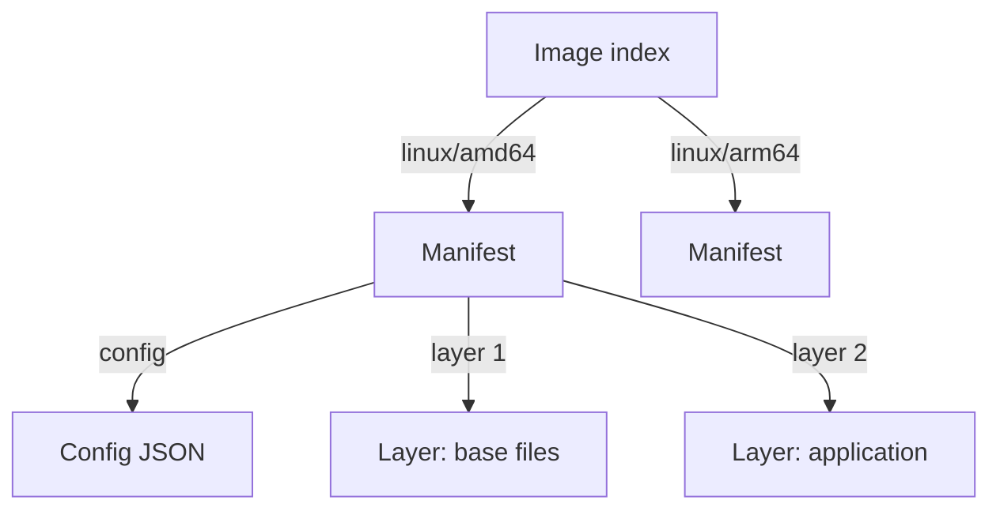

# Layers, Tags And Digests

Two pods can show the same image name and still run different content. A pod can also run an image that holds ten times more software than the application needs. Both problems start with the same question: what exactly is an image, and how does a cluster refer to it? This part answers that question and then looks at the images that already run in the playground cluster.

## What an image is made of

An image is a set of files stored in a registry, which is a server that stores and distributes container images. The files are organised as an OCI (Open Container Initiative) image. Four objects matter:

- A **layer** is a compressed archive (a tar file) of filesystem changes: files added, changed or removed. Each instruction in a Dockerfile that changes the filesystem, such as `RUN`, `COPY` or `ADD`, creates a layer.
- The **config** is a JSON document with the start-up settings (entrypoint, command, user, environment variables, exposed ports) and the list of layer hashes.
- The **manifest** is a JSON document that lists the config and the layers by digest.
- The **image index** (also called a manifest list) lists one manifest for each platform, such as `linux/amd64` and `linux/arm64`. A node picks the manifest that matches its own architecture and operating system.



The diagram shows that a tag points at an index, the index points at one manifest per platform, and a manifest points at the config and the layers that the node downloads.

A layer is shared. If ten images start from the same base image, the registry stores that base layer once, and a node downloads it once. A layer is also permanent: a file that a later layer deletes is hidden from the final filesystem, but it stays in the earlier layer and anyone who pulls the image can extract it. This detail returns in the part about Dockerfile hardening.

## Tags and digests

A **tag** is a name for an image in a repository, such as `busybox:1.37.0`. The publisher can move a tag to different content at any time, so a tag is a convenience and not an identity. The tag `latest` is only a name; it does not mean the newest build.

A **digest** is the SHA-256 hash of the manifest (or index), written as `sha256:` followed by 64 hexadecimal characters. If one byte of the content changes, the digest changes. A reference with a digest, such as `docker.io/library/busybox@sha256:<digest>`, always selects the same bytes. The container runtime checks the downloaded content against the digest and refuses content that does not match.

When both are written (`busybox:1.37.0@sha256:<digest>`), the runtime uses the digest and ignores the tag. Tools such as Renovate and Dependabot can still read the tag as a comment-like hint and update the digest. The practical rule for supply chain work is simple: use tags to find versions, and use digests to say which version runs.

## The images that already run in the cluster

The playground has a `probe` Deployment and two client pods. In the next steps you read which image reference each pod asked for and which digest the node actually ran.

<!-- astrona:playground:renew -->

First select the playground cluster and check the context, so that no command can reach another cluster:

```sh
export KUBECONFIG="$(astrona kubeconfig ats-035-playground-010-01)"
test "$(kubectl config current-context)" = "kind-astro-ats-035-playground-010-01" || exit 1
worker_name="astro-ats-035-playground-010-01-worker"
```

Ask for the image that the `shuttle` pod requested and the image that its container runtime reported. The `image` field in the pod status is the reference from the pod spec; the `imageID` field is what the container runtime resolved it to.

```sh
kubectl -n starfleet get pod shuttle -o jsonpath='{.spec.containers[0].image}{"\n"}{.status.containerStatuses[0].image}{"\n"}{.status.containerStatuses[0].imageID}{"\n"}'
```

The first line is the tag you wrote in the pod specification. The last line has the form `docker.io/library/busybox@sha256:` followed by a digest. On a node whose images were loaded from an archive instead of pulled, the field can hold an image ID of the form `sha256:<digest>` without a repository name; that value identifies the image config on that node. When you see the repository form, that digest is the identity of the content that is running, and it is the value you would record in an incident report. If a tag moves tomorrow, this value still names the content that this container started from.

Now compare the two images that run in the `starfleet` namespace. The `probe` pods use a general-purpose image with a Python interpreter and the Alpine package manager, and the `shuttle` pod uses BusyBox, which provides one small program with many applets:

```sh
kubectl -n starfleet exec deploy/probe -- sh -c 'cat /etc/os-release | head -n 2; apk info | wc -l; which python'
kubectl -n starfleet exec shuttle -- sh -c 'ls /bin | wc -l; which python'
```

In the `probe` pod you see the Alpine release name, a count of the installed packages and the path of the Python interpreter. In the `shuttle` pod you see a count of the programs in `/bin` and no output for `which python`, because no Python interpreter exists in that image. Neither count is a measure of risk, but each package is a file set that can contain a vulnerability, and each program in `/bin` is a tool that a person with shell access can use.

The node holds the images. The container runtime on a `kind` node is containerd, and `crictl` is its command-line client. Run it inside the worker node container to list the images with their digests:

```sh
podman exec "$worker_name" crictl images --digests
```

Find the `busybox` and `python` rows. The columns show the repository, the tag, the digest and the local size. The digest in this table is the one that you read from the pod status. Note that the same digest can appear with several tags, because tags are only names for it.

## Why the footprint matters

A smaller final image has three direct effects. A scanner reports fewer packages and therefore fewer findings. An attacker who gains code execution inside the container finds no shell, no package manager and no compilers to download and run more tools. The node also transfers and stores less data on every pull. The size is not the goal by itself: a small image built on an old base can be worse than a larger image that receives security fixes. The goal is that the image contains what the application needs at run time and nothing else.

You can now read the tag, the digest and the contents of the images that run in a cluster. The next question is how to build an image that contains only the application and its run-time files, even though the build needs a compiler and other tools.

## Common pitfalls

> [!WARNING]
> - **Treating a tag as an identity.** The publisher can move `1.37.0` or `latest` to other content. Record the digest from `imageID` when you must know what ran.
> - **Reading the `image` field as proof of what ran.** `spec.containers[].image` is what you asked for. Only `status.containerStatuses[].imageID` is what the runtime resolved.
> - **Assuming that deleting a file in a later layer removes it from the image.** The earlier layer still contains the file.
> - **Judging an image only by its size.** A small image with an unpatched base still carries vulnerabilities. Size and freshness both matter.
