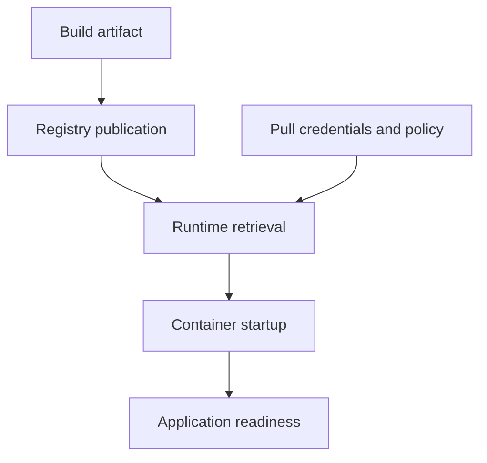

# From Build To Image Pull

An image builds successfully on your machine, but the node cannot start it. The build result establishes a local artifact; it does not establish publication, registry access or compatibility with the node. Locate the failing stage before changing the application.

## Learning objectives

- Explain image layers and immutable digests.
- Distinguish tags from exact image identity.
- Trace image retrieval and registry authentication.

## Before you start

This chapter is standalone reading material; no running cluster or installed tools are required. A Pod is the Kubernetes unit for running one or more containers, and a namespace groups namespaced objects. Treat the worked configurations as teaching examples rather than recorded observations from a provisioned environment.

## Responsible components and behavior

An image build turns source files and instructions into an artifact. A Dockerfile is a common format for expressing build steps and runtime defaults. The build environment supplies tools and dependencies; the resulting image should contain what the application needs to execute, rather than every development tool.

A multi-stage build uses separate stages so build tools and intermediate files need not remain in the final runtime image. Smaller images can reduce transfer time and unnecessary components, but size alone does not prove security. Dependencies still need review, patches and an appropriate execution identity.

After a successful build, a publisher uploads the artifact to a registry. A node runtime pulls the referenced image when needed according to the workload's image pull policy and local availability. The build, publication and pull stages can fail independently. An image built on a developer's machine is not automatically available from the registry.

Common pull failures include a missing repository or tag, rejected credentials, unreachable registry, certificate problems and incompatible architecture. Kubernetes can report an initial pull error and later delay retries with an image pull backoff. That delay is a response to repeated failure, not the underlying cause.

Credentials for a private registry must be available through the intended mechanism, such as image pull Secrets referenced by the Pod or its ServiceAccount. Application credentials placed inside the image do not automatically authenticate image downloads. Embedding build secrets in image layers can also expose them to anyone with artifact access.

Read a pull failure by identifying the exact reference, network reachability, credentials and platform compatibility. Increasing replicas only creates more attempts at the same unresolved dependency. Fixing the source artifact or access path allows normal startup to continue.

## Build Inputs And Secret Exposure

A build instruction can copy files from its build context, a selected set of input files. Accidentally including credentials, private keys or unnecessary development data can expose them in an image layer. Removing a file in a later build layer does not guarantee its bytes were never present in an earlier distributed layer.

Multi-stage builds can keep compilers and intermediate artifacts out of the final image, but authors still need to choose what crosses into the runtime stage. Pinning dependencies and base inputs improves traceability. Scanning and provenance checks add evidence about contents and origin without proving every runtime behavior is safe.

Build-time credentials and runtime credentials also have different jobs. A credential used to download a private dependency during compilation should not automatically remain in the final application image. A registry pull credential enables the node to retrieve an artifact; a database credential enables the process to use its data service after startup.

## Distinguishing Pull Failure Categories

A not-found registry response suggests the reference or publication must be checked. An authentication rejection suggests the node's pull identity or permission. A certificate error concerns trust or transport validation. A platform mismatch concerns the image variants and node architecture. These categories predict different corrective changes.

The pull policy determines when retrieval or verification through the registry is attempted relative to local image availability. Defaulting can depend on the initial image reference, so an author should read the actual admitted policy instead of inferring it from a tag after later edits. A cached artifact can also make behavior differ between nodes.

A corrected reference or credential should allow the runtime to move beyond pulling, but later startup can still fail. Verify the transition and then application readiness. An image-pull success is a completed dependency step, not a guarantee that the process configuration or listener works.

## Work through the decision

The kubelet asks the container runtime to obtain the Pod's selected image. Registry authentication happens before the application process exists. A database password inside that application cannot authenticate this earlier download. Image pull Secrets and other supported node credential mechanisms serve the retrieval boundary instead.

The Pod's admitted `imagePullPolicy` also matters. `IfNotPresent` can reuse a cached image; `Never` requires the image already to be available to the runtime; `Always` asks the registry to resolve the selected reference when starting. Inspect the actual policy because changing an image reference later does not automatically re-default an already stored policy. A pull backoff is delayed retry behavior, so the preceding failure message remains the diagnostic clue.

Each stage has its own inputs and failure evidence; a successful build proves only the first stage.

You can now place a retrieval failure before application startup and choose evidence from that stage. Once retrieval succeeds, command, configuration and health checks still determine whether the application becomes usable.

## Common pitfalls

> [!WARNING]
> A local build is not a registry publication. Image pull backoff describes delayed retries; inspect the reported failure to find the actual problem.
