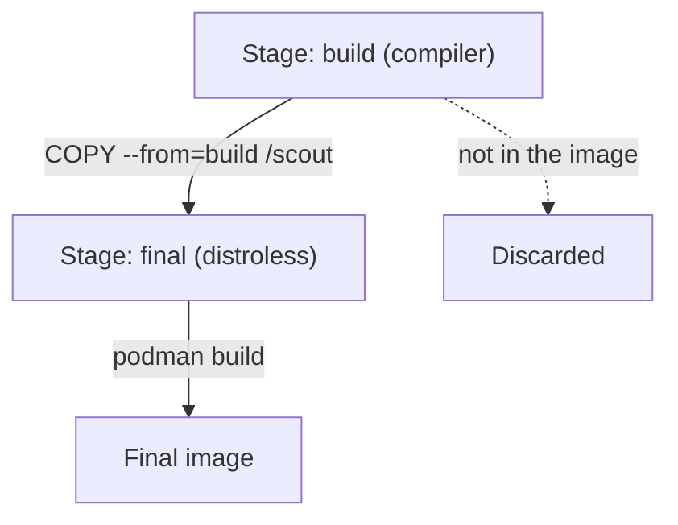

# Multi-Stage Builds And Minimal Base Images

A program needs a compiler to be built, but it does not need the compiler to run. If the compiler stays in the final image, the image is large, it holds hundreds of packages that a scanner must report on, and an attacker who reaches a shell finds a full toolchain. A multi-stage build solves this by building in one stage and copying only the result into a small final stage. In this part you build the same program twice, with and without stages, and compare the two images.

## How a multi-stage build works

A Dockerfile is the text file that tells the container engine how to build an image. A **stage** starts at each `FROM` instruction. The last stage becomes the final image. An earlier stage can be given a name with `AS`, and a later stage copies files out of it with `COPY --from=<name>`. Everything else in the earlier stages, such as the compiler, the source code and the package cache, is not part of the final image.



The diagram shows that only the file copied with `COPY --from` crosses from the build stage into the final image.

The choice of the final base image decides how much else ships with the program. The common options are:

- **A full distribution image** such as `debian` or `ubuntu`. It has a shell, a package manager and many libraries. It is the easiest to debug and the largest.
- **Alpine** (`docker.io/library/alpine`). It uses the musl C library and BusyBox, and it is small, but it still has a shell and the `apk` package manager.
- **Distroless** (`gcr.io/distroless/...`). These images hold the files a program needs to run, such as CA certificates, time zone data and a C library where needed, and no shell and no package manager. The `static` variant is for programs without any C library dependency, and the `base` and `cc` variants add the C libraries. The `nonroot` tag sets a non-root user.
- **`scratch`**. This is an empty image. It has no files at all, so the program must be a static binary that brings everything it needs, and it must include CA certificates itself if it makes TLS connections.

## Build the same program twice

The program is a small Go web server. A Go program can compile into one static binary, which fits distroless `static` and `scratch` images. Create a new empty folder and save this as `main.go`:

<!-- astrona:playground:renew -->

```go
package main

import (
	"fmt"
	"net/http"
)

func main() {
	http.HandleFunc("/", func(w http.ResponseWriter, r *http.Request) {
		fmt.Fprintln(w, "scout")
	})
	http.ListenAndServe(":8080", nil)
}
```

Save this as `Dockerfile.single`. It uses one stage, so the compiler stays in the final image:

```dockerfile
FROM docker.io/library/golang:1.25
WORKDIR /src
COPY main.go .
RUN go mod init scout && go build -o /scout .
ENTRYPOINT ["/scout"]
```

Save this as `Dockerfile.multi`. The first stage builds and the second stage only receives the binary:

```dockerfile
FROM docker.io/library/golang:1.25-alpine AS build
WORKDIR /src
COPY main.go .
RUN go mod init scout && CGO_ENABLED=0 go build -o /scout .

FROM gcr.io/distroless/static-debian12:nonroot
COPY --from=build /scout /scout
USER 65532:65532
ENTRYPOINT ["/scout"]
```

`CGO_ENABLED=0` tells the Go compiler not to link the C library, so the binary is static and runs on the `static` image. The `USER` line sets the user ID and group ID 65532, which is the `nonroot` user of the distroless images. Build both images. The first build downloads the Go toolchain image, so it takes longer than the second:

```sh
podman build -f Dockerfile.single -t scout:single .
podman build -f Dockerfile.multi -t scout:multi .
```

Then check the result by listing both images and comparing the SIZE column:

```sh
podman images scout
```

The `scout:multi` image is smaller than `scout:single` by a large factor, because the single-stage image still contains the whole Go toolchain and the Debian packages under it. Both images start the same program.

Next, compare what each image lets a person do. Start the multi-stage image, send one request, and try to open a shell in it:

```sh
podman run -d --rm --name scout-multi -p 8080:8080 scout:multi
curl http://127.0.0.1:8080
podman exec scout-multi sh
```

The `curl` command prints `scout`. The `podman exec` command fails because the image has no `sh` program, and the error says the executable file was not found. The same command works in `scout:single`, where an attacker would also find `go`, `git` and `apt`. Stop the container before you continue:

```sh
podman stop scout-multi
```

## Reading the layers

`podman history` shows the layers of an image and the instruction that created each one. Run it on both images and compare:

```sh
podman history scout:multi
```

The final image has only the layers of the distroless base image and one layer for the copied binary. In the single-stage image, the history shows the large layers of the Go base image under the `go build` layer. Build tools in any layer of the final image are a finding for a scanner, even when the program no longer uses them.

## Choosing the final base

Use `scratch` or distroless `static` for static binaries, as in Go and Rust programs. Use distroless `base`, `cc` or a language variant (Java, Python, Node.js) when the program needs a runtime. Use Alpine when you need a package manager at build time or a very small image with a shell for debugging. Use a full distribution only when the application depends on its packages. Whatever you choose, update the base image regularly: a minimal image with an old base still carries the vulnerabilities of that base.

A distroless image has no shell, which also removes the usual way to debug it. Distroless publishes `:debug` tags that add a BusyBox shell, but the better habit is to keep the production image minimal and debug with an ephemeral container, which the last part of this module shows.

You now know how a multi-stage build separates the build tools from the final image and how the base image choice sets the footprint. The final image is small, but it can still run as root, hold copied-in secrets or pull in files you did not mean to include. The next part covers those mistakes in the Dockerfile itself.

## Common pitfalls

> [!WARNING]
> - **Leaving `COPY --from` out and building everything in the last stage.** The result is a single-stage image with all build tools.
> - **Using a dynamically linked binary on `scratch` or distroless `static`.** The program fails at start because the C library is missing. Build a static binary (`CGO_ENABLED=0` for Go).
> - **Missing CA certificates on `scratch`.** HTTPS calls fail. Copy the certificates from the build stage or use a distroless image, which includes them.
> - **Choosing the final image by size only.** A small image with an old base still has known vulnerabilities. Rebuild on a current base.
