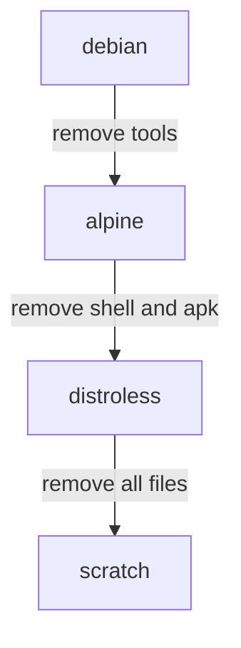

# What Each Base Image Contains

Two images can run the same program and still differ by hundreds of packages. The difference comes from the base image that the Dockerfile starts from. This part describes the four common kinds of base image and then compares two of them inside the playground cluster.

## Four kinds of base image

A base image is the image named in the first `FROM` line of a Dockerfile. Its layers become the bottom layers of every image built on top of it. The four kinds below are ordered from the most to the least content.

- **A Debian or Ubuntu image** holds a full Linux user space: the GNU C library (`glibc`), the `bash` shell, the `apt` package manager and many standard tools. Most software runs on it without changes. Its slim variants remove documentation and some tools but keep `apt`.
- **An Alpine image** holds a small Linux user space built on the `musl` C library, the BusyBox program for the standard tools and the `apk` package manager. It is a few megabytes in size. Some programs that expect `glibc` behave differently or fail on `musl`.
- **A distroless image** holds the files that a program needs at run time, such as CA certificates, time zone data and a `/etc/passwd` file with a non-root user. It has no shell and no package manager. Variants exist for static binaries, for programs that need `glibc` and for runtimes such as Python and Java.
- **The `scratch` image** is empty. It holds no files at all. A program can run on it only if it is a static binary, which means a binary that contains all the code it needs and loads no shared libraries.



The diagram orders the images by content. Going down the chain removes tools that an attacker could use after a first foothold, and it also removes tools that you would use to debug a problem.

## Why the C library matters

A program written in C, or in a language that links to C code, loads a C library at start. `glibc` and `musl` provide the same standard functions but behave differently in details such as name resolution and memory use. A binary built against `glibc` does not start on a `musl` image, because the file the binary asks for (the dynamic loader) does not exist there.

A Go program built with `CGO_ENABLED=0` is a static binary. It needs no C library, so the same file runs on Debian, Alpine, distroless and `scratch`. That is why static binaries make the smallest images.

## Compare two images in the cluster

The playground has one Alpine based image (`python:3.13-alpine`, used by the `probe` pods) and one BusyBox image (`busybox:1.37.0`, used by the `shuttle` pod). You read the contents of both.

<!-- astrona:playground:renew -->

First select the playground cluster and check the context, so that no command can reach another cluster:

```sh
export KUBECONFIG="$(astrona kubeconfig ats-035-playground-010-02)"
test "$(kubectl config current-context)" = "kind-astro-ats-035-playground-010-02" || exit 1
```

Read the operating system name, the C library loader and the number of installed packages inside a `probe` pod:

```sh
kubectl -n starfleet exec deploy/probe -- sh -c 'head -n 2 /etc/os-release; ls /lib/ld-musl*; apk info | wc -l'
```

The first two lines name Alpine Linux and its version. The `ls` command lists the `musl` dynamic loader, which confirms the C library. The last number is the count of installed `apk` packages. The `python` interpreter is one of them, together with its libraries.

Now look at BusyBox. It ships one program that provides many commands, and the commands in `/bin` are links to it:

```sh
kubectl -n starfleet exec shuttle -- sh -c 'ls -l /bin/sh; busybox | head -n 3; ls /bin | wc -l'
```

The listing shows that `sh` is a link to `busybox`. The `busybox` command prints its version and a usage text, and the last number is the count of commands in `/bin`. This image has no package manager, so the count of packages does not exist, but the shell and the standard tools are all present.

Last, check whether either image can run a language that the other has:

```sh
kubectl -n starfleet exec shuttle -- sh -c 'which python || echo "no python in this image"'
kubectl -n starfleet exec deploy/probe -- sh -c 'which python && python --version'
```

The first command prints the fallback text, because BusyBox has no Python interpreter. The second prints the path of the interpreter and its version.

## What the comparison shows

The `probe` image is larger because it carries a language runtime and a package manager that the application may not need after the build. The `shuttle` image is smaller because it carries one program. Neither has the final form of a minimal production image: both keep a shell, so a person or a program with code execution inside the container can run commands. A distroless image removes the shell as well, and the only way to inspect it is an ephemeral debug container.

You can now name what each kind of base image contains and read it from a running pod. The next question is what a process can reach once it runs in a container, and how a pod limits that reach.

## Common pitfalls

> [!WARNING]
> - **Choosing Alpine for every program.** A program built for `glibc` can fail or behave differently on `musl`. Test the program on the final image.
> - **Using `scratch` for a dynamic binary.** The program fails at start because its dynamic loader and libraries are missing.
> - **Reading a package count as a risk score.** Fewer packages mean fewer places for a vulnerability, but one old package can matter more than fifty current ones.
