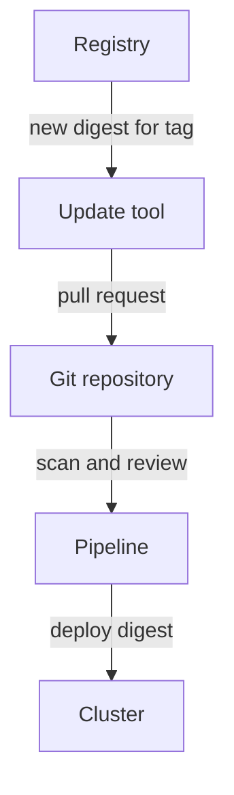

# Pin Images By Digest And Keep The Pin Current

A tag such as `3.13-alpine` can point at different content next week. A deployment that uses the tag can therefore run different software on two nodes, or after a restart, without any change in Git. A digest removes that uncertainty, and it creates a new task: someone must move the digest forward when the publisher releases a fix.

## What a digest pin gives you

A digest is the SHA-256 hash of an image manifest. A reference of the form `docker.io/library/busybox@sha256:<digest>` selects exactly one manifest. The container runtime checks the downloaded bytes against the digest and refuses content that does not match. Three benefits follow:

- Every node runs the same bytes, even if the tag moves between pulls.
- A review of the manifest in Git shows exactly which image was approved, and an admission policy can require the digest form.
- An incident report can name the content by its digest.

A digest also has a cost. The reference no longer tells a person which version it is, and nothing updates it. A pinned image that is never updated keeps every vulnerability it had on the day it was pinned. The usual compromise is to write the tag as well and let a tool maintain the digest: `busybox:1.37.0@sha256:<digest>`. The runtime uses the digest and ignores the tag, and the tag tells a reader which release the digest belongs to.

## Tools that move the pin

Renovate and Dependabot are tools that open a pull request when a newer image exists. They read the tag and the digest from your Dockerfile, Kubernetes manifest or Helm values file, find the newest content for that tag in the registry and propose the new digest. A person or a pipeline reviews the change, runs a scan and merges it. The pin stays exact and still moves forward.



The update tool never changes the cluster directly. The change reaches the cluster through the same review and deployment path as any other change.

## Read a digest and run a pinned workload

You read the digest that the node resolved for the `probe` image and start a second Deployment that uses it.

<!-- astrona:playground:renew -->

```sh
export KUBECONFIG="$(astrona kubeconfig ats-035-playground-010-03)"
test "$(kubectl config current-context)" = "kind-astro-ats-035-playground-010-03" || exit 1
```

Read the image reference that was requested, the policy that applies, and the content that the runtime resolved:

```sh
kubectl -n starfleet get pod -l app=probe -o jsonpath='{.items[0].spec.containers[0].image}{"\n"}{.items[0].spec.containers[0].imagePullPolicy}{"\n"}{.items[0].status.containerStatuses[0].imageID}{"\n"}'
```

The first line is the tag, the second line is `IfNotPresent` because the tag is not `latest`, and the third line holds the image name, `@sha256:` and the digest. Copy only the characters after `sha256:`. This command prints them alone:

```sh
kubectl -n starfleet get pod -l app=probe -o jsonpath='{.items[0].status.containerStatuses[0].imageID}' | sed 's/.*@sha256://'
```

Save this as `deployment-pinned-probe.yaml` and replace `<PROBE_DIGEST>` with the characters from the previous command:

```yaml
apiVersion: apps/v1
kind: Deployment
metadata:
  name: pinned-probe
  namespace: starfleet
spec:
  replicas: 1
  selector:
    matchLabels:
      app: pinned-probe
  template:
    metadata:
      labels:
        app: pinned-probe
    spec:
      containers:
      - name: app
        image: docker.io/library/python:3.13-alpine@sha256:<PROBE_DIGEST>
        imagePullPolicy: IfNotPresent
        command:
        - python
        - -c
        - import time; time.sleep(3600)
```

Apply it:

```sh
kubectl apply -f deployment-pinned-probe.yaml
```

Then check the result. The status of the new pod shows the digest that it runs:

```sh
kubectl -n starfleet rollout status deployment/pinned-probe --timeout=120s
kubectl -n starfleet get pod -l app=pinned-probe -o jsonpath='{.items[0].status.containerStatuses[0].imageID}{"\n"}'
```

The last line ends with the same digest that you copied. The pod runs the content that the `probe` pods run, and it will run exactly that content on any node and after any restart.

You can now pin an image to a digest and know that the pin needs an owner. The next part covers the rules that decide when a node downloads an image, and when to replace a pinned image.

## Common pitfalls

> [!WARNING]
> - **Pinning once and never updating.** A pin freezes the vulnerabilities as well. Use an update tool and rebuild on a schedule.
> - **Pinning the digest of one platform.** An image index lists one manifest for each CPU architecture. The digest of the index works on every node, while the digest of a single manifest works only on its architecture.
> - **Copying an image ID of the form `sha256:` without a repository.** That value names the image configuration on one node and is not a pullable reference.
