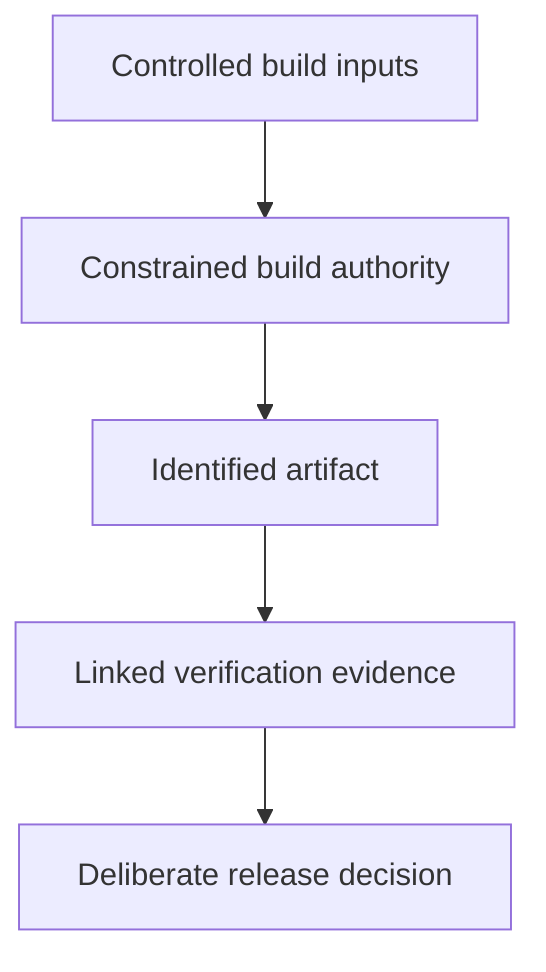

# Artifact Evidence And Sensitive Build Inputs

A compiler stage uses a private credential, then a later layer deletes its file. The deletion does not prove that earlier distributed image content never exposed it.

## Learning objectives

- Trace source, build, publication and deployment trust boundaries.
- Distinguish provenance, signatures, inventories and vulnerability findings.
- Relate admission decisions to exact artifact identity.

## Before you start

This chapter is standalone reading material; no running cluster or installed tools are required. A Pod is the Kubernetes unit for running one or more containers, and a namespace groups namespaced objects. Treat the worked configurations as teaching examples rather than recorded observations from a provisioned environment.

## Responsible components and behavior

A database password should reach only the process that needs it. Least privilege applies to credential readers, mounted files, ServiceAccounts and network access as well as application programming interface (API) permissions. Do not put secrets in an image merely to avoid configuring them at deployment time; image access can expose all embedded layers.

A Kubernetes Secret requires access control and appropriate encryption at rest. Applications should avoid writing sensitive values into logs, error pages or diagnostic bundles. Rotation needs coordination between the credential issuer and consumers so old values stop working without causing an unnecessary outage.

Image supply chain security asks where an artifact came from, what it contains and whether it is the intended artifact. A digest identifies content. A signature or provenance record can support verification of origin and build history. A vulnerability scan looks for known problems in identified components. These answer different questions.

A signed image can still contain a vulnerability, and a clean scan cannot prove that the publisher is trusted or that every future vulnerability is known. A software bill of materials (SBOM) records components to support analysis. It does not independently prove safe application behavior.

Prefer trusted sources, reviewed dependencies and repeatable builds. Keep runtime privileges minimal, patch components and verify the intended artifact through the delivery process. Avoid mutable references when exact release identity matters.

Suppose an approved image has a valid signature but an exploitable dependency. The signature is useful evidence of origin, yet the dependency still needs remediation. Security reasoning should identify the property being checked rather than treating one passed check as a complete guarantee.

## Artifact Identity, Origin And Contents

An image digest answers which content is selected. A signature can answer whether a trusted identity attested to that content, assuming the verification policy and trust material are correct. Provenance can describe source and build steps. A component inventory can show included libraries. A vulnerability scan compares identified components with known problem data.

None of these questions is interchangeable. A digest by itself does not identify a trustworthy publisher. A signature does not prove that the signed code has no defect. An inventory without a trustworthy link to the built image can describe the wrong artifact. A scan may not detect an unknown flaw or a logic error in the application's own authorization checks.

A delivery policy can require several pieces of evidence for the exact artifact being promoted. Store the relationship between source revision, build identity, digest and verification result. Checking one image and deploying another weakens every apparently successful control.

## Credential Exposure Along The Runtime Path

A credential can leak through source files, build inputs, registry layers, mounted files, environment inspection, logs or diagnostic exports. Moving it into a Secret addresses some configuration concerns but not all these paths. Limit who can read it and which process receives it, then prevent accidental disclosure through normal and failure behavior.

Rotation must also remove old authority at the issuer. Updating a stored value while leaving the previous credential valid indefinitely does not revoke it. New consumers need to adopt the replacement according to their configuration delivery mechanism. Verification should use successful intended access and rejected old access where appropriate, without publishing the secret value.

Supply chain controls and least privilege support different phases of defense. The first narrows what software and credentials enter the system; the second limits what a compromised process can do. A coherent security answer connects both rather than treating a signed artifact as permission to run with unrestricted host access.

## Work through the decision

Build inputs include source, dependencies, tools and credentials used to retrieve private material. A build can execute untrusted scripts, so its authority must be constrained independently of deployment authority. Avoid including sensitive inputs in distributed layers or uncontrolled build output.

Provenance, signatures, component inventory and vulnerability findings describe different artifact properties. Link each result to the exact content selected for release. A trusted signature does not remove a known dependency vulnerability, and a scan with no findings does not identify a trusted publisher. Review both the evidence producer's authority and the runtime privileges granted to the resulting workload.

A supply-chain decision needs protected inputs and evidence about the exact artifact, with each check's limits stated.

A supply-chain decision needs protected inputs and evidence about the exact artifact, with each check's limits stated.

## Common pitfalls

> [!WARNING]
> Signatures, digests, vulnerability scans and component inventories provide different evidence. Passing one check does not establish every aspect of workload safety.
