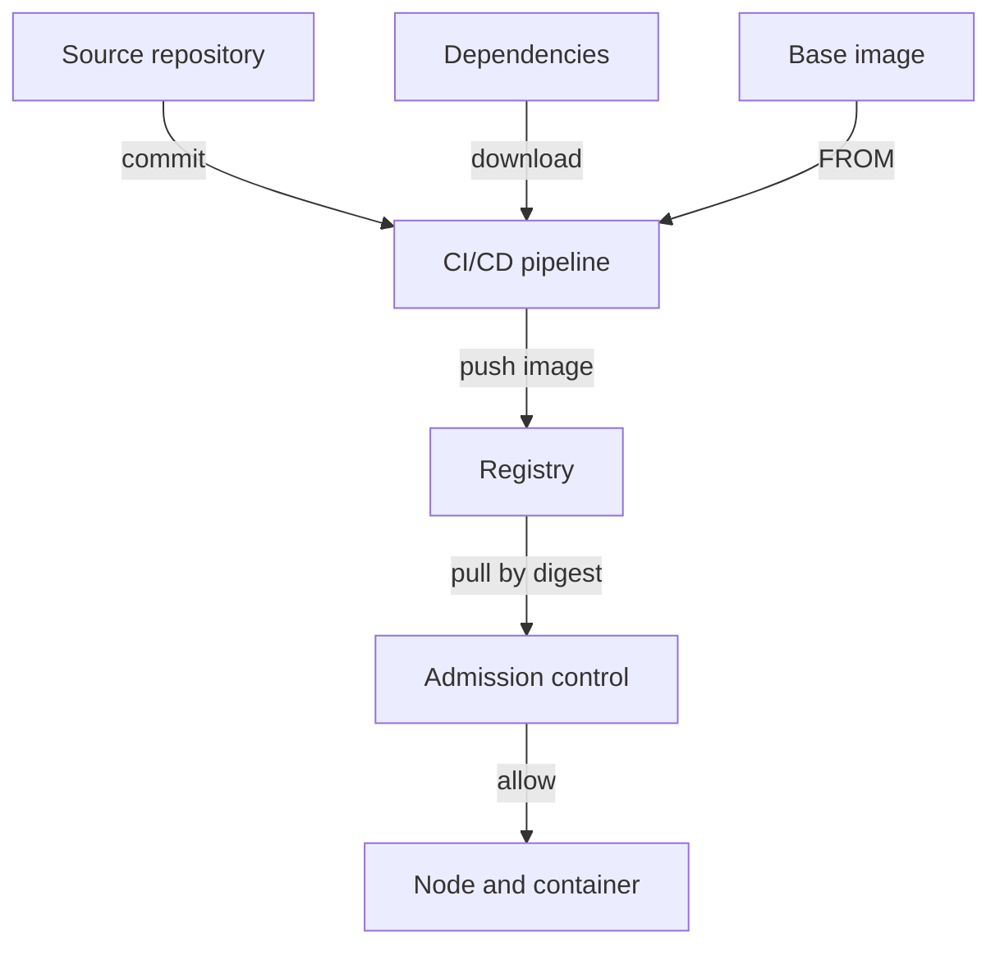

# Stages, Trust Boundaries And Evidence

Teams often ask whether an image is "secure" as if one answer could exist. The question breaks into smaller ones: what is inside it, who built it, from which source, and has anyone changed it since? Each question has a different kind of evidence, and each kind of evidence has limits. This part maps the stages of the chain and then lists what runs in the playground cluster, which is the first thing you need before any other control.

## The stages of the chain

A **supply chain** in this course is every step between a line of source code and a running container. Each step takes input from the previous step and produces an artifact for the next one.



The diagram shows that the pipeline takes three inputs (source, dependencies and base image), and that the registry and admission control stand between the pipeline and the node.

The boundary between two stages is where an attacker can change an artifact. Typical attacks match the stages:

- At the source: a malicious commit, or a stolen developer account.
- In the dependencies: a package that a maintainer or an attacker replaces, or a package with a name similar to an internal one (dependency confusion).
- In the pipeline: a stolen build credential, a modified pipeline definition, or a build step that runs untrusted code with access to secrets.
- In the registry: a tag that someone moves to other content, or write access given to too many people.
- At the node: an image that no policy checked before it ran.

## What each kind of evidence proves

Four kinds of evidence belong to an artifact. They answer different questions, and none of them replaces another.

- A **software bill of materials (SBOM)** is a list of the components inside an artifact, such as operating system packages and libraries, with versions. It answers "what is in it?" and does not say whether the components are vulnerable.
- A **vulnerability report** is the result of matching the components against a database of known vulnerabilities (CVEs, Common Vulnerabilities and Exposures) at one moment in time. It answers "which known problems does it have today?".
- A **signature** binds a digest to an identity or a key. It answers "did this signer publish exactly these bytes?" and does not say the content is safe.
- A **provenance attestation** is a signed statement about how an artifact was built: the source commit, the builder and the build steps. It answers "where and how was it built?". The SLSA (Supply-chain Levels for Software Artifacts) framework defines levels of build integrity that provenance supports.

All four must refer to the same digest. A report about the tag `1.0` says nothing certain about the content that a node runs today, because the tag can move.

## List what runs in the cluster

You cannot protect what you cannot list. The first inventory is the set of images that the cluster runs now.

<!-- astrona:playground:renew -->

Select the playground cluster and check the context:

```sh
export KUBECONFIG="$(astrona kubeconfig ats-035-playground-020-01)"
test "$(kubectl config current-context)" = "kind-astro-ats-035-playground-020-01" || exit 1
```

List every image reference in all namespaces, without duplicates:

```sh
kubectl get pods -A -o jsonpath='{range .items[*].spec.containers[*]}{.image}{"\n"}{end}' | sort -u
```

The list contains the `python` and `busybox` images from the example workloads and the images of the cluster components in `kube-system`, such as `kube-apiserver`, `etcd` and `coredns`, which come from `registry.k8s.io`. This shows the registries the cluster depends on. A policy that allows only some registries must account for every one of them.

Now list the content that the runtime resolved for each container:

```sh
kubectl get pods -A -o jsonpath='{range .items[*].status.containerStatuses[*]}{.image}{"  "}{.imageID}{"\n"}{end}' | sort -u
```

Each line pairs the requested reference with the `imageID`. The reference can be a tag, but the `imageID` identifies the content. On a node that loaded an image from an archive, the value can be a `sha256:` image ID without a registry name. Two limits apply to both commands: init containers appear under `initContainerStatuses`, and ephemeral containers under `ephemeralContainerStatuses`, so a complete inventory reads those fields too.

You now have a map of the chain and a first inventory of the images that run. An inventory of images does not say what is inside them. The next part creates that list of components with an SBOM tool.

## Common pitfalls

> [!WARNING]
> - **Treating one kind of evidence as proof of safety.** A signature does not say the content is free of vulnerabilities, and a clean scan does not say who built it.
> - **Recording tags in the inventory.** Tags move. Record the digest from `imageID`.
> - **Forgetting init and ephemeral containers.** They run code too, and they have their own status fields.
> - **Ignoring the base image and dependencies.** Most of the code in an image comes from them, not from your repository.
