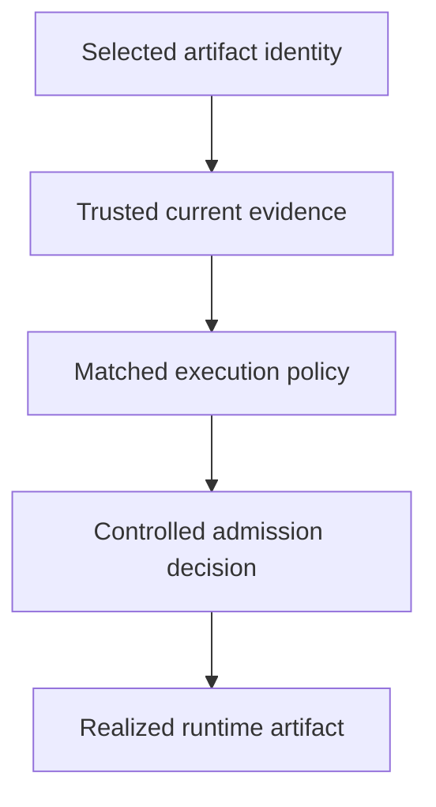

# Connecting Verification To Execution Policy

A scanner approves yesterday's digest, but the deployment still uses a tag that now resolves to different content. The successful result no longer describes the selected execution input.

## Learning objectives

- Trace source, build, publication and deployment trust boundaries.
- Distinguish provenance, signatures, inventories and vulnerability findings.
- Relate admission decisions to exact artifact identity.

## Before you start

This chapter is standalone reading material; no running cluster or installed tools are required. A Pod is the Kubernetes unit for running one or more containers, and a namespace groups namespaced objects. Treat the worked configurations as teaching examples rather than recorded observations from a provisioned environment.

## Responsible components and behavior

A supply chain is the sequence of people, systems and inputs that produces and distributes software. For `scout`, it includes source review, dependencies, build tools, publication credentials, registry content and the deployment process. A trustworthy release requires evidence across these boundaries, not only a trusted repository hostname.

## Inputs And Build Authority

Source changes can introduce unwanted behavior, and dependencies can change without an obvious application edit. Record the source revision and controlled dependency inputs. Protect the process that resolves those inputs and the identity allowed to publish the resulting artifact.

Build jobs can execute code from scripts, tools or dependencies. Giving that environment production administrator credentials expands the consequence of a malicious input. Separate build authority from delivery authority and avoid exposing unnecessary secrets to untrusted stages.

Provenance describes relevant origin and build information. Its usefulness depends on who produced it, how it is protected and whether it refers to the exact artifact. A text record generated by an untrusted build does not automatically become trustworthy merely by containing plausible fields.

## Evidence With Different Meanings

A digest identifies content. A signature can establish an attestation by a trusted identity according to verification policy. A software bill of materials identifies components. A vulnerability result reports known findings within a particular scope and time. These pieces complement each other because they answer different questions.

Evidence must be linked to the artifact selected for execution. A scanner result for yesterday's tag content cannot approve today's different digest simply because the visible tag name stayed the same. Build and deployment records should preserve that relationship.

Supply chain frameworks such as Supply-chain Levels for Software Artifacts (SLSA) organize assurance around build and source-related practices. They do not mean every artifact following one process is free of application defects. Evaluate the specific assurance statement and remaining risk instead of treating a framework label as complete security.

## Policy Enforcement At A Decision Point

A platform can require approved identity, provenance or scan evidence before allowing an artifact into a deployment workflow. The enforcement component must know what evidence is trusted and how missing or invalid evidence is handled. A pipeline check, registry rule and cluster admission check occupy different positions in the chain.

If a policy is fail-open when its verification service is unavailable, deployment availability improves at the cost of permitting requests without that check. Fail-closed protects the rule but can block legitimate changes during an outage. Choose and document the behavior according to risk and maintain a reliable operating path.

Exceptions need ownership and scope. A permanent broad bypass can defeat the policy while preserving an apparently strict default. Audit evidence should reveal when an exception was used and for which artifact.

## Maintenance And Incident Scope

New vulnerability information can appear after release. Reassess deployed artifacts and maintain a patching process rather than relying forever on a scan that once passed. A revoked publisher key or compromised build system can also change trust in previously approved content.

If a build was compromised, investigate published artifacts, credentials and deployments connected to it. Correct source and build trust, replace exposed authority and promote reviewed replacement content. Running a new Pod from the same untrusted artifact does not restore confidence.

A useful supply chain explanation connects inputs, evidence and enforcement to the deployed digest. It should identify what the evidence proves, who can alter it and which application risks remain after policy acceptance.

## Work through the decision

Policy needs a decision point that evaluates relevant evidence for the actual selected artifact. Image digests provide content identity; verified attestations can add origin or build claims. The policy must define trusted producers, acceptable findings and supported exceptions.

Admission can participate in that decision, but its coverage depends on resource matching, failure behavior and the installed implementation. Build-time checks alone can be bypassed by another delivery path. A permissive exception can also widen authority beyond its stated purpose. Preserve the artifact-to-evidence relationship through submission and runtime observation rather than relying on a familiar tag name.

Verification protects execution through an enforced, covered decision about the same artifact that actually runs.

Verification protects execution through an enforced, covered decision about the same artifact that actually runs.

## Common pitfalls

> [!WARNING]
> Evidence for one artifact does not approve another digest under the same tag. Provenance, signatures and scans provide different assurances, and passed checks need continued maintenance and controlled exceptions.
