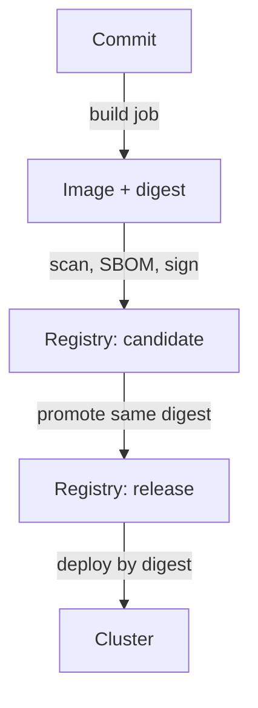

# CI/CD Pipelines And Artifact Repositories

The CI/CD pipeline holds the keys to everything it publishes: it can write to the registry, and often it can deploy to the cluster. An attacker who controls the pipeline does not need to break the cluster, because the pipeline already has permission to change it. The artifact repository, which is the registry or package store that holds the build output, is the second place where trust is decided. This part lists the controls for both and then configures the cluster side of a private registry login.

## Controls for the pipeline

A pipeline runs code on a runner, which is the machine or container that executes the steps. Treat each of these as a separate control:

- **Short-lived credentials.** Prefer a token that the pipeline obtains for one run through OpenID Connect (OIDC) identity federation over a password stored as a long-lived secret. A leaked short-lived token expires.
- **Least privilege.** The build job needs permission to push one repository. It does not need permission to read cluster Secrets or to deploy. Separate the build identity from the deploy identity, so that a compromise of one does not give the other.
- **Fresh, isolated runners.** A runner that is created for one job and destroyed afterwards leaves nothing for the next job to find. A shared runner that keeps files between jobs can leak credentials and cached content.
- **Pinned inputs.** Pin base images and pipeline actions or plugins by digest or commit hash, not by a tag that someone can move.
- **Reviewed pipeline definitions.** The file that defines the pipeline is code. Require review for changes to it, and protect the branch that deploys.
- **Secrets kept out of logs and layers.** Pass build secrets with a secret mount (`RUN --mount=type=secret`), not `ARG` or `COPY`, and mask secrets in logs.
- **Build once, promote by digest.** Build the image once, scan and test that digest, and promote the same digest through staging to production. Do not rebuild for each environment, because a rebuild produces different content.



The diagram shows that every later step refers to the digest that the build job produced, so the checks apply to the same content that reaches the cluster.

## Controls for the artifact repository

A registry stores images and the evidence that belongs to them. The settings that matter are:

- **Authentication and authorization.** Use private repositories for internal images. Give the push right to the pipeline identity only, and give nodes a read-only credential.
- **Immutable tags.** When the registry supports it, make tags immutable so that a published tag cannot point to other content.
- **Separate repositories for stages.** Keep candidate images and release images apart, so that a release repository only contains images that passed the checks.
- **Scanning on push and retention rules.** Scan new images when they arrive, and delete old images by rule, so that deprecated content cannot be pulled by mistake.
- **A mirror or pull-through cache.** Cluster nodes can pull from an internal registry that caches approved public images, which reduces the exposure to public registry outages and tag changes.

## Give the cluster a registry credential

A kubelet pulls from a private registry with credentials that you store in a Secret of type `kubernetes.io/dockerconfigjson`. A pod lists the Secret in `imagePullSecrets`, or the pod's ServiceAccount lists it and every pod that uses the ServiceAccount inherits it. The exercise uses fake values and a made-up registry name, so no real registry is contacted.

<!-- astrona:playground:renew -->

Select the playground cluster and check the context:

```sh
export KUBECONFIG="$(astrona kubeconfig ats-035-playground-020-01)"
test "$(kubectl config current-context)" = "kind-astro-ats-035-playground-020-01" || exit 1
```

Save this as `dockerconfig.json`. The `auth` value is the Base64 encoding of `demo-user:demo-password`:

```json
{
  "auths": {
    "registry.example": {
      "username": "demo-user",
      "password": "demo-password",
      "auth": "ZGVtby11c2VyOmRlbW8tcGFzc3dvcmQ="
    }
  }
}
```

Create the Secret from the file. Passing the file avoids putting the password on the command line, where the shell history and the process list would record it:

```sh
kubectl -n starfleet create secret generic registry-credentials \
  --type=kubernetes.io/dockerconfigjson \
  --from-file=.dockerconfigjson=dockerconfig.json
```

Attach the Secret to the `default` ServiceAccount of the namespace, so that new pods use it:

```sh
kubectl -n starfleet patch serviceaccount default -p '{"imagePullSecrets":[{"name":"registry-credentials"}]}'
```

Then check the result. Read the ServiceAccount, and decode the Secret to see what it holds:

```sh
kubectl -n starfleet get serviceaccount default -o jsonpath='{.imagePullSecrets}{"\n"}'
kubectl -n starfleet get secret registry-credentials -o jsonpath='{.data.\.dockerconfigjson}' | base64 -d
```

The first command prints the list with the Secret name. The second prints the JSON you saved. This shows an important limit: a Secret is Base64 encoded, not encrypted, so anyone with `get` permission on Secrets in the namespace can read the password. Ask the API server whether the `default` ServiceAccount itself can read Secrets:

```sh
kubectl auth can-i get secrets -n starfleet --as=system:serviceaccount:starfleet:default
```

The answer is `no`, because no role binding gives the ServiceAccount that permission. Pull credentials should be read-only, scoped to the repositories the namespace needs, and rotated. Remove the exercise objects:

```sh
kubectl -n starfleet patch serviceaccount default -p '{"imagePullSecrets":null}'
kubectl -n starfleet delete secret registry-credentials
```

You now know which controls protect the pipeline and the registry, and how a cluster authenticates to a private registry. A pull credential only proves who is pulling. It does not prove what the image is, so the cluster still needs a separate rule for which images it may run.

## Common pitfalls

> [!WARNING]
> - **Storing a long-lived push token as a pipeline secret.** Anyone who can change the pipeline can read it. Use short-lived federated credentials.
> - **Giving the build identity cluster-admin rights.** A compromised build then controls the cluster.
> - **Rebuilding the image for each environment.** The tested digest and the deployed digest differ. Promote one digest.
> - **Calling a Secret encrypted.** Base64 is an encoding. Limit who can read Secrets with RBAC and enable encryption at rest.
> - **Using one registry credential for the whole cluster with write access.** Use read-only credentials, scoped per namespace.
