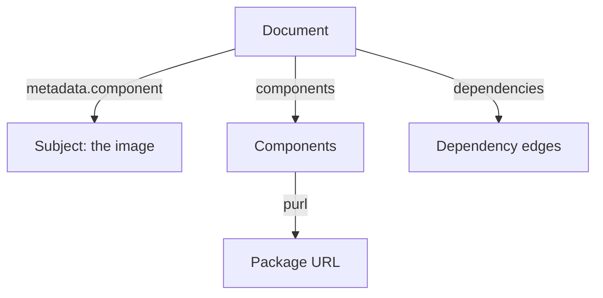

# Reading SPDX And CycloneDX Documents

Two teams can both say "we have an SBOM" and still be unable to exchange them, because one team writes SPDX and the other writes CycloneDX. Each format answers the same question, which components are in the artifact, with different field names. This part shows the fields you must be able to find in each format, explains the package URL that names a component, and builds a package URL from real package data.

## The structure of an SPDX document

SPDX (Software Package Data Exchange) is an open standard of the Linux Foundation. A JSON SPDX 2.3 document has a header and three lists that matter for security work.

- `spdxVersion`, `dataLicense`, `SPDXID` and `name` identify the document itself. `documentNamespace` is a unique string for this document.
- `creationInfo` records when the document was created and which tool created it.
- `packages` lists the components. Each package has a `name`, a `versionInfo`, a `downloadLocation`, license fields and `externalRefs`. An external reference of type `purl` carries the package URL.
- `relationships` links the elements. `DESCRIBES` links the document to the root package, `CONTAINS` links an image to a package and `DEPENDS_ON` links one package to another.

The relationships list is the part that a flat package list does not give you. It tells a reader which package is the subject of the document and which packages came in as dependencies of others.

## The structure of a CycloneDX document

CycloneDX is an open standard of the OWASP (Open Worldwide Application Security Project) foundation. It was designed for security use. A JSON CycloneDX 1.5 document has these top-level fields.

- `bomFormat` is the fixed word `CycloneDX`, and `specVersion` is the version of the format.
- `serialNumber` and `version` identify this document and its revision.
- `metadata` records the creation time, the tools and the `component` that the document describes.
- `components` lists the components. Each has a `type` such as `library`, `application`, `container` or `operating-system`, a `name`, a `version`, a `purl` and optionally licenses and hashes.
- `dependencies` lists, for each component reference, the references it depends on.



The diagram shows a CycloneDX document: the subject, the component list, the dependency edges and the package URL on each component. SPDX has the same pieces under different names. Choose the format that your consumers accept; the content is what matters.

## The package URL

A package URL (purl) is a standard string that names a package without depending on one tool. Its form is `pkg:type/namespace/name@version?qualifiers`. The type names the package system. For Alpine it is `apk`, and the namespace is `alpine`. For Python packages the type is `pypi`.

Scanners use the package URL to look up vulnerabilities, so a wrong type, name or version produces a wrong result without any error message. A purl for the Alpine C library package has the form `pkg:apk/alpine/musl@<version>`, with the version taken from the package database. Real tools often add qualifiers such as the CPU architecture. This module leaves the qualifiers out to keep the strings short.

## Build package URLs from a running pod

A catalog tool such as Syft finds packages with catalogers. A cataloger is a part of the tool that reads one kind of source. The `apk` cataloger reads the Alpine package database in the image; other catalogers read Python metadata, Go binaries or Java archives. A package that no cataloger recognises does not appear in the SBOM.

You can do the same job by hand for the Alpine packages. First select the playground cluster and check the context:

<!-- astrona:playground:renew -->

```sh
export KUBECONFIG="$(astrona kubeconfig ats-035-playground-020-02)"
test "$(kubectl config current-context)" = "kind-astro-ats-035-playground-020-02" || exit 1
```

Ask the `apk` package manager in a `probe` pod for its installed packages. The `-v` option prints each package with its version and release, in the form `name-version-release`:

```sh
kubectl -n starfleet exec deploy/probe -- apk info -v | sort | head -n 5
```

The output is five lines, each a package name followed by a version such as `1.2.5-r10`. A package name can contain dashes, so the version starts at the second dash from the end. The next command rewrites each line into a package URL with `sed`:

```sh
kubectl -n starfleet exec deploy/probe -- apk info -v | sort | head -n 5 | sed -E 's/^(.*)-([^-]+-r[0-9]+)$/pkg:apk\/alpine\/\1@\2/'
```

Each line now has the form `pkg:apk/alpine/<name>@<version>`. This is the value of the `purl` field of a component in a CycloneDX document, and of the `purl` external reference of a package in an SPDX document. Count the packages to compare with the `components` count of any SBOM of this image:

```sh
kubectl -n starfleet exec deploy/probe -- apk info -v | wc -l
```

On your own machine, Syft writes both formats for the same image, and the package counts of the Alpine packages should match this number. The image also holds Python packages, which are not in the Alpine database, so a full SBOM has more components than this count.

You can now read the fields of both formats and build the name that scanners use for a component. The task on the next page records such a component list for the running image, in the same structure that CycloneDX uses.

## Common pitfalls

> [!WARNING]
> - **Treating the formats as different content.** SPDX and CycloneDX describe the same components with different field names. Compare names, versions and package URLs.
> - **Splitting a package line at the first dash.** Names such as `ca-certificates-bundle` contain dashes. The version and release are the last two parts.
> - **Trusting a count without a scope.** The Alpine database is one source. Python and other language packages come from other catalogers.
> - **Reading qualifiers as optional noise.** Architecture and distribution qualifiers can change which vulnerability data applies.
