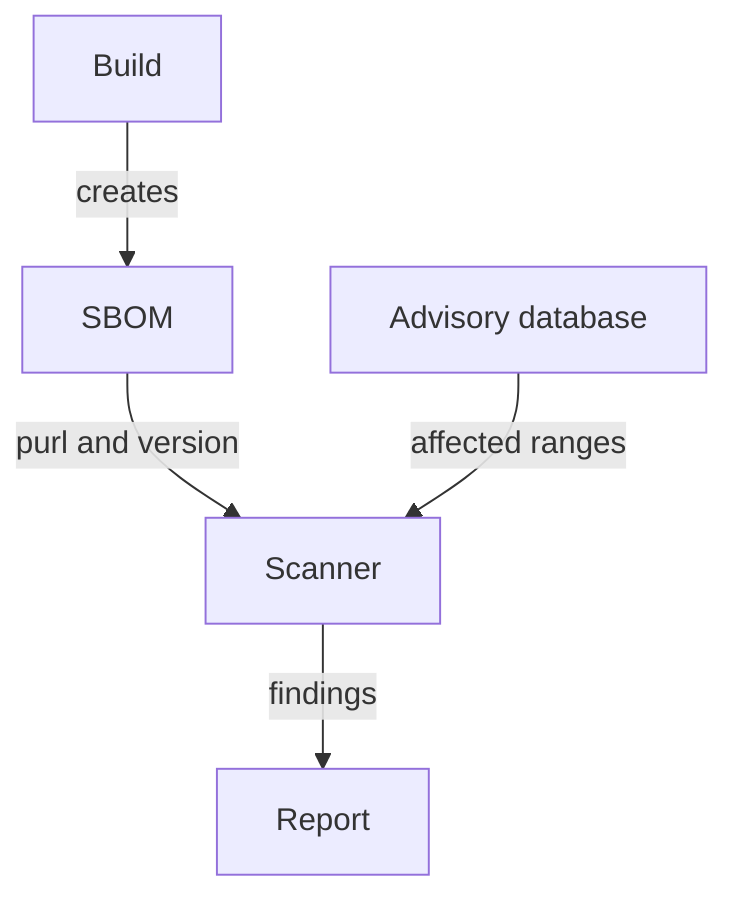

# Matching An SBOM To Vulnerabilities And An Image Digest

A component list is only useful at the moment someone asks a question about it: is this library affected by the vulnerability announced today? Answering needs two links. The first link joins each component to vulnerability data. The second link joins the whole SBOM to the one image that it describes. This part explains both links, shows how a VEX statement changes a finding, and states what an SBOM can never tell you.

## From components to findings

A scanner reads the components of an SBOM and looks each one up in a vulnerability database. The lookup key is the package URL, or a CPE (Common Platform Enumeration) name for software without a package URL, together with the version. A finding appears when the version falls in the affected range of an advisory. The advisory sources are the distribution maintainers, language ecosystems and the national vulnerability database.

Trivy reads an SBOM with `trivy sbom <file>`, and Grype, another scanner, reads one with `grype sbom:<file>`. Both work from the stored document and do not need the image. This lets a team scan the SBOM of every released image each day, without pulling images, when a new advisory appears.



The matching is only as good as the SBOM. A component that is missing from the list is never checked, and a component with the wrong version is checked against the wrong range.

## VEX: saying that a finding does not apply

A scanner finds a vulnerable package; it does not know whether your program calls the vulnerable function. A VEX (Vulnerability Exploitability eXchange) statement is a signed or stored claim about one vulnerability in one product. Its status is one of `not_affected`, `affected`, `fixed` or `under_investigation`. A `not_affected` status comes with a justification, such as "the vulnerable code is not reachable". CycloneDX and the OpenVEX format can both carry such statements.

A VEX statement lowers the noise in a report, but it is a claim made by a person or a tool. Treat it like an exception: record who made it, why, and when it must be reviewed.

## Bind the SBOM to an image digest

An SBOM for `python:3.13-alpine` is ambiguous, because the tag moves. An SBOM for `python@sha256:<digest>` names exactly one image. The `subject` of the document must therefore be the digest. In the cluster, the digest of what runs is in the `imageID` field of the pod status.

<!-- astrona:playground:renew -->

```sh
export KUBECONFIG="$(astrona kubeconfig ats-035-playground-020-02)"
test "$(kubectl config current-context)" = "kind-astro-ats-035-playground-020-02" || exit 1
kubectl -n starfleet get pod -l app=probe -o jsonpath='{range .items[*]}{.metadata.name}{" "}{.status.containerStatuses[0].imageID}{"\n"}{end}'
```

The command prints one line for each `probe` pod, with the pod name and its image ID. Both replicas must show the same value, because both start from one image. If the value is only a `sha256:` image ID without a repository, the node loaded the image from an archive. The image ID is then the identity of the image configuration on that node, and you record it in the same way.

Now compare the image ID with the reference in the pod specification:

```sh
kubectl -n starfleet get deployment probe -o jsonpath='{.spec.template.spec.containers[0].image}{"\n"}'
```

The specification holds a tag, and the status holds the resolved identity. An SBOM record that names only the tag cannot prove which content it describes.

## Attach the SBOM to the image with an attestation

Keeping the SBOM in a separate folder breaks the link to the image. An attestation fixes this. An attestation is a signed statement about a subject. The subject is an image digest, and the statement type says what the payload is. Cosign, the signing tool of the Sigstore project, can attach an SBOM as an attestation to an image in a registry. These commands run on your own machine, against a registry that you control:

```sh
syft scan <registry>/<repository>@<digest> -o cyclonedx-json=sbom.cdx.json
cosign attest --key cosign.key --type cyclonedx --predicate sbom.cdx.json <registry>/<repository>@<digest>
cosign verify-attestation --key cosign.pub --type cyclonedx <registry>/<repository>@<digest>
```

The first command creates the SBOM from the digest. The second signs it and stores it in the registry next to the image. The third checks the signature and the type before a consumer trusts the content. Replace the placeholders with your own registry, repository and digest.

## What an SBOM does not say

An SBOM states which components are present. It does not state which components are exploitable, which are loaded at run time, or whether the image was built by a trusted pipeline. A signature on an SBOM proves who signed it and that it was not changed; it does not prove that the list is complete. Pair the SBOM with a scan for findings, a VEX statement for exceptions and a provenance attestation for the build, and keep each one tied to the digest.

You now know how an SBOM becomes a list of findings and how it stays attached to one image.

## Common pitfalls

> [!WARNING]
> - **Matching an SBOM that names a tag.** The tag can move to other content after the SBOM was made. Use the digest.
> - **Reading "no findings" as "no vulnerabilities".** A scan finds only what the database knows and what the SBOM lists.
> - **Accepting a VEX status without a reason.** A `not_affected` status needs a justification and a review date.
> - **Treating a signed SBOM as a complete one.** The signature proves origin and integrity, not coverage.
