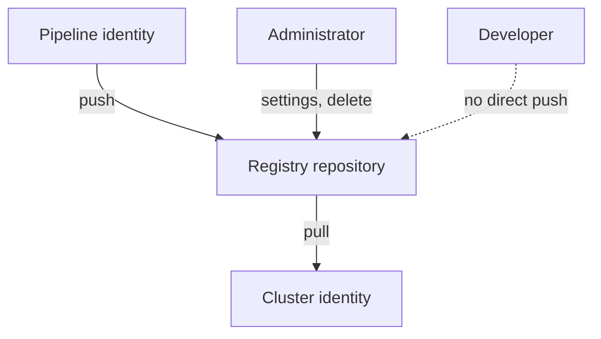

# Registries, Repositories And Who May Push Or Pull

Every image that runs in a cluster was stored in a registry first. If an attacker can write to that registry, the attacker can change what the next pod runs, without touching the cluster or the source code. This part explains the objects in a registry, the settings that protect them, and the rule that pushing and pulling need different identities.

## Registry, repository, tag and digest

A registry is a server that stores and serves container images over a standard API. A repository is a named collection of related images inside a registry, such as `library/python`. An image in a repository has a manifest, identified by its digest. A tag is a movable name for a digest. The full reference `registry.example.test/team/probe:1.4` therefore has four parts: the registry host, the repository path, the tag and, once resolved, the digest.

Artifact repositories are broader than image registries. The same idea applies to package repositories for libraries, Helm charts and SBOMs. The control question is always the same: who may write, who may read, and what happens to old content.

## Controls on the repository

Registries differ in features, and many offer the following settings.

- **Immutable tags.** The registry refuses to move a tag to a new digest. A tag such as `1.4` then keeps meaning one build. Without this setting, a push can silently replace the content behind a tag that deployments already use.
- **Separate roles.** A pipeline identity can push to one repository. A cluster identity can pull from the repositories it needs. Developers have neither right by default. Administrators who can delete or change settings are a small, separate group.
- **Retention rules.** The registry removes old or untagged images by rule, so the repository does not hold forgotten images with known vulnerabilities. A retention rule must never delete an image that a deployed workload still references.
- **Vulnerability and signature checks.** Some registries scan on push and can block a pull until the image passes or carries a valid signature.
- **Audit logs.** The registry records which identity pushed, pulled or deleted which image.
- **Mirrors and pull-through caches.** A cluster pulls from an internal mirror that holds only approved images. The mirror is the one place where external content enters.



The diagram shows four identities with four different rights on one repository. The dashed arrow marks a right that the developer does not have.

## See what the cluster asked for and what it got

The pod specification holds the reference that someone wrote. The pod status holds what the runtime resolved. Both matter for registry controls: a mutable tag in the specification means the registry decides the content, and the status shows what it decided.

<!-- astrona:playground:renew -->

```sh
export KUBECONFIG="$(astrona kubeconfig ats-035-playground-020-03)"
test "$(kubectl config current-context)" = "kind-astro-ats-035-playground-020-03" || exit 1
kubectl -n starfleet get pods -o custom-columns='NAME:.metadata.name,REQUESTED:.spec.containers[0].image,POLICY:.spec.containers[0].imagePullPolicy'
```

The table has one row for each pod, with the requested image and the pull policy. A policy of `IfNotPresent` means the node reuses an image it already holds with the same reference, so a moved tag does not reach a node that cached the old content. A policy of `Always` makes the kubelet contact the registry at each container start. The kubelet still compares digests, so it downloads layers only when the content changed. When a pod has no tag or uses the tag `latest`, Kubernetes sets the policy to `Always`.

Now read the resolved identity of the same pods:

```sh
kubectl -n starfleet get pods -o custom-columns='NAME:.metadata.name,RESOLVED:.status.containerStatuses[0].imageID'
```

A reference with a digest removes the dependence on tag rules. It is the reference to use for production workloads, together with a registry that refuses to delete the digest while it is in use.

## Common failure: a pull that is denied

When the node cannot pull, the pod shows `ErrImagePull` and then `ImagePullBackOff`. The event message names the reason. A message with `unauthorized` or `authentication required` means the registry refused the credential or received none. A message about a missing manifest means the tag or digest does not exist. You can list the events of the namespace with:

```sh
kubectl -n starfleet get events --sort-by=.lastTimestamp
```

In the healthy playground the list shows normal start events and no pull failures. In the next part you will give a service account a credential so that pods can pull from a registry that requires login.

## Common pitfalls

> [!WARNING]
> - **One shared administrator credential for the cluster.** A leaked secret then reaches every repository. Use one read-only identity for each purpose.
> - **Mutable tags in production manifests.** The content behind the tag can change without any change in the cluster.
> - **Retention rules that delete deployed images.** A pod that restarts on a node without the image then fails to pull.
> - **Letting developers push to production repositories.** Only the pipeline identity should push there.
