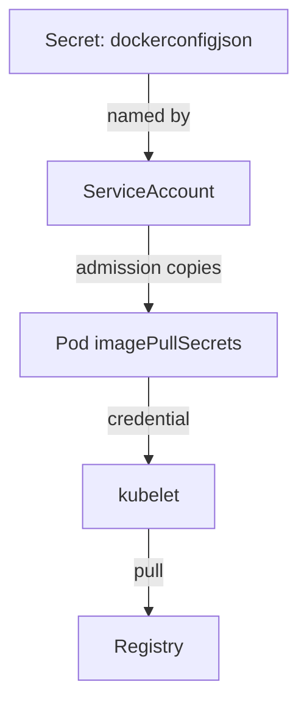

# Pull Secrets And Service Accounts

A private registry answers only requests that carry a credential. The kubelet, which is the agent on each node that starts containers, needs that credential before it can pull. Kubernetes has a defined way to hand the credential to the kubelet without writing it into every pod. This part explains the secret type, the pod field and the service account field that carry the credential, and how to set them.

## The secret type

A secret of type `kubernetes.io/dockerconfigjson` holds registry credentials in the key `.dockerconfigjson`. The value is a JSON document in the same format as a Docker client configuration file. It has an `auths` object with one entry for each registry host. An entry holds a `username`, a `password` and an `auth` field with the Base64 encoding of `username:password`.

A secret is not encrypted by default, only Base64-encoded when read from the API. Limit who can read secrets with RBAC (role-based access control), and give the credential only the right to pull the repositories it needs.

A pull secret belongs to a namespace. A pod can use only the pull secrets in its own namespace.

## Two places to name the secret

The first place is the pod. The field `spec.imagePullSecrets` is a list of secret names. The kubelet tries these credentials when it pulls the images of that pod.

The second place is the service account. A service account is the identity that a pod runs as. Its field `imagePullSecrets` lists secrets too. When a pod is created, an admission step adds the pull secrets of the pod's service account to the pod. Naming the secret once on the service account therefore covers every pod that uses that account, including pods that a Deployment creates later.



The diagram shows the path of the credential. The secret is named in the service account, the pod receives the name at creation, and the kubelet uses the secret at pull time.

## Look at the shape of a pull secret

Kubernetes can build the secret object for you from a host, a user and a password. The option `--dry-run=client` prints the object without creating it. The host, user and password below are examples:

<!-- astrona:playground:renew -->

```sh
export KUBECONFIG="$(astrona kubeconfig ats-035-playground-020-03)"
test "$(kubectl config current-context)" = "kind-astro-ats-035-playground-020-03" || exit 1
kubectl -n starfleet create secret docker-registry demo-credentials \
  --docker-server=registry.example.test \
  --docker-username=reader \
  --docker-password=example-password \
  --dry-run=client -o yaml
```

The output is a Secret with `type: kubernetes.io/dockerconfigjson` and a `.dockerconfigjson` value that is Base64-encoded. Nothing was created in the cluster. To read the JSON inside, decode the value:

```sh
kubectl -n starfleet create secret docker-registry demo-credentials \
  --docker-server=registry.example.test \
  --docker-username=reader \
  --docker-password=example-password \
  --dry-run=client -o jsonpath='{.data.\.dockerconfigjson}' | base64 --decode
```

The JSON has an `auths` object keyed by `registry.example.test`, with the user, the password and the `auth` field. The key in `auths` must match the registry host in the image reference. If the host differs, the kubelet does not use the entry.

## Attach the secret to a service account

The service account `probe-runner` exists in the `starfleet` namespace and has no pull secrets. Check it:

```sh
kubectl -n starfleet get serviceaccount probe-runner -o yaml
```

Add the secret name to the service account in a file. Save this as `serviceaccount-probe-runner.yaml`:

```yaml
apiVersion: v1
kind: ServiceAccount
metadata:
  name: probe-runner
  namespace: starfleet
imagePullSecrets:
- name: demo-credentials
```

Apply it:

```sh
kubectl apply -f serviceaccount-probe-runner.yaml
```

Then check the result:

```sh
kubectl -n starfleet get serviceaccount probe-runner -o jsonpath='{.imagePullSecrets[*].name}{"\n"}'
```

The service account now names `demo-credentials`. The secret itself does not need to exist for the service account to accept the name, but a pod that must pull with it fails to pull when the secret is missing. In the task on the next page you create the secret, attach it and run a pod that receives it.

## Common pitfalls

> [!WARNING]
> - **Creating the secret in the wrong namespace.** A pod cannot use a pull secret from another namespace.
> - **A registry host that does not match.** The `auths` key must match the host in the image reference.
> - **Using the credential of a person.** Use a dedicated identity with pull-only rights, and rotate it.
> - **Changing the service account after the pod exists.** The admission step runs at pod creation, so existing pods keep their old list.
