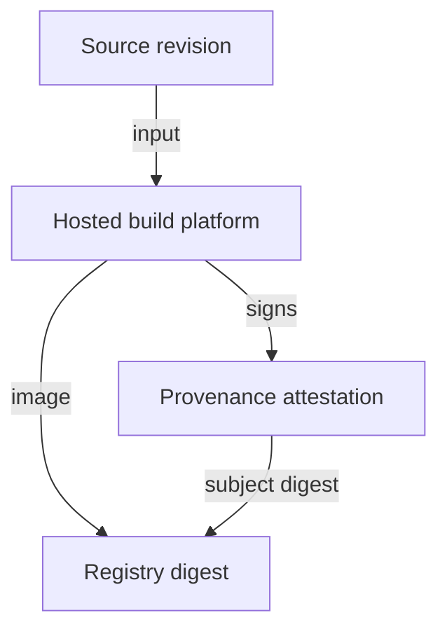

# Build Provenance And SLSA Levels

A registry shows who pushed an image, but not how the image was made. Provenance fills that gap. Provenance is a record of how an artifact was built: which source revision, which builder and which inputs. A consumer who can check the record can reject an image that was built from the wrong source or on a machine that nobody controls. This part explains what provenance contains and what the SLSA levels promise.

## What provenance contains

A provenance statement is a signed document whose subject is an artifact digest. Its payload names the build in structured fields.

- The **subject**: the image digest that the build produced.
- The **builder**: the identity of the build platform that ran the build.
- The **build definition**: the build type, the parameters and the resolved dependencies, including the source repository and the exact commit.
- The **run details**: which build run produced the artifact and when it started and ended.

The in-toto framework defines the statement format that wraps these fields, and Sigstore tools sign and store it as an attestation in the registry, next to the image.

## SLSA in plain terms

SLSA (Supply-chain Levels for Software Artifacts) is a set of requirements for build integrity. The build track of SLSA version 1.0 has levels from 1 to 3 for the producer.

| Level | What the producer provides |
| --- | --- |
| Build L1 | Provenance exists. It shows how the artifact was built. It can be incomplete and it is not signed. |
| Build L2 | The build runs on a hosted build platform that signs the provenance. A consumer can detect a forged record. |
| Build L3 | The build platform is hardened. Builds are isolated from each other, and the signing key is not reachable from the build steps. A build cannot forge its own provenance. |

A higher level does not mean the source code is free of flaws. It means the link between the source revision and the artifact is harder to fake.

The diagram shows the build platform producing the image and a signed attestation whose subject is the digest in the registry.

## How a consumer checks provenance

The consumer does not read the provenance by eye. A policy compares fields to expected values and rejects the image on a mismatch. Typical checks are that the builder identity is the approved pipeline, the source repository is the expected one, and the commit is on a protected branch. Cosign can verify the attestation signature and type before the policy reads the payload. An admission policy can run the same check when a pod is created.

For a release record inside the cluster you can store the facts that the check needs: the image digest, the builder identity, the source revision and the format of the SBOM. The record helps an incident review, but the signed attestation in the registry is the evidence. A note in a ConfigMap is a convenience and proves nothing by itself.

## Limits of provenance

Provenance proves that a specific builder produced the digest from the stated inputs. It does not prove that the inputs were safe. A compromised dependency that the build fetched is recorded faithfully. For that reason provenance is read together with the SBOM, a vulnerability scan and the source control rules for review and branch protection.

You now know how registries, pull credentials and provenance fit together: the registry controls who may write, the service account controls which credential the cluster uses to read, and the provenance records how the content was built.

## Common pitfalls

> [!WARNING]
> - **Reading unsigned provenance as proof.** An unsigned record can be written by anyone who can write to the registry.
> - **Checking that provenance exists but not what it says.** Compare the builder, the repository and the commit with expected values.
> - **Equating a SLSA level with security.** The level describes build integrity, not code quality.
> - **Storing the only copy in a note.** Keep the signed attestation in the registry, tied to the digest.
