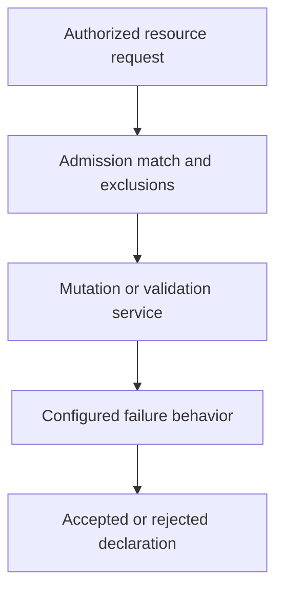

# Admission As A Controlled Resource Decision

A validating webhook cannot be reached. Its configured failure policy determines whether affected requests are rejected or can continue. Policy availability and security coverage therefore interact.

## Learning objectives

- Distinguish mutation, validation and authorization.
- Explain built-in, declarative and webhook admission mechanisms.
- Relate failure policy and exemptions to effective enforcement.

## Before you start

This chapter is standalone reading material; no running cluster or installed tools are required. A Pod is the Kubernetes unit for running one or more containers, and a namespace groups namespaced objects. Treat the worked configurations as teaching examples rather than recorded observations from a provisioned environment.

## Responsible components and behavior

A caller has permission to create Pods, but the platform requires approved runtime privileges and image evidence. Admission is a decision stage for relevant application programming interface (API) changes after authentication and authorization. It can modify supported fields or reject a proposed resource according to policy.

## Mutation And Validation

A mutating mechanism can supply defaults or inject supporting configuration. A validating mechanism checks whether the resulting declaration is allowed. Defaults should not be confused with proof that every requested behavior is safe. The final admitted object can differ from the source, so effective configuration needs inspection.

Built-in admission controllers implement supported cluster behavior. Pod Security Admission checks defined Pod configuration standards. Declarative admission policies can express supported validation logic within the API system. Webhooks call an external service for mutation or validation. Their mechanisms and operating dependencies differ.

Authorization asks whether the identity may request an action. Admission asks whether the resource change meets additional policy. A narrowly authorized deployer can still submit an unsafe declaration, and a safe-looking declaration can still be submitted by an unauthorized caller. Both checks remain necessary.

## External Webhook Trust

A webhook needs a reachable serving endpoint, trusted transport and a correct decision implementation. Its configuration defines which requests it receives. A selector or exclusion can leave some resources outside its coverage. A broad-looking policy name does not establish universal matching.

The service can hold sensitive request data and needs appropriate access and logging controls. Mutation can change security-relevant fields, so the webhook's own code, image and credentials join the platform trust chain. Protect who can change its configuration or replace its serving workload.

Timeouts and failure policy determine what happens when the service does not return a usable decision. Fail-closed can preserve a requirement while blocking legitimate resource changes during an outage. Fail-open can preserve deployment availability while allowing requests without that check. Neither outcome should be inferred from the fact that a webhook exists.

## Scope And Exceptions

Policies can match particular resource types, namespaces or operations. Exemptions can support required system workloads but also create bypasses. Each exception needs a reason, owner and reviewable scope. Protect authority to weaken the rule or change labels used for matching.

Image evidence illustrates the need for a precise contract. A validation service should relate trusted signatures or scan results to the exact selected artifact. Evidence attached only to a mutable tag can approve different content after a tag update. A successful policy check proves the configured rule passed, not that the application has no defect.

## Operating And Reviewing Policy

Before tightening enforcement, identify affected templates and the resulting acceptance behavior. Warning or audit evidence can support a migration where the mechanism provides it. Compatibility checks should establish that legitimate workloads can meet the rule without disabling required controls.

Observe policy service health and rejection reasons. An unavailable webhook can become a control-plane availability issue, while an incorrect match can silently omit intended coverage. Retain evidence sufficient to explain a decision without logging secrets unnecessarily.

A complete admission review states the matching scope, decision logic, trusted implementation, failure behavior and exceptions. This turns an intended rule into a testable operating contract and reveals which risks still belong to runtime and application controls.

## Work through the decision

Admission evaluates relevant authorized resource-changing requests. Mutation can alter requested fields, while validation can reject the resulting declaration. A webhook is itself a service with transport trust, runtime dependencies and credentials, rather than an infallible rule stored in a name.

Review matching resources, namespace selectors, exclusions, supported versions and failure behavior. A narrow match can leave a risky path unchecked; a broad fail-closed policy can also block necessary operation during an outage. Test the intended covered and excluded cases, protect the extension's code and authority, and record justified exception boundaries. Admission does not replace caller authorization or runtime detection.

An admission policy's effect depends on coverage, trusted implementation and behavior when its dependencies fail.

An admission policy's effect depends on coverage, trusted implementation and behavior when its dependencies fail.

## Common pitfalls

> [!WARNING]
> A registered webhook does not prove every request is covered or blocked on failure. Mutation, validation, matching, exemptions and availability determine the actual admission contract.
