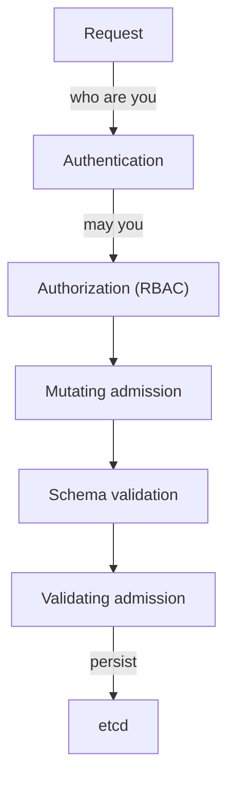

# The Admission Pipeline And ValidatingAdmissionPolicy

Role-based access control (RBAC) decides whether a user may create a pod. It does not look at what is inside the pod. A user who may create pods can ask for any image from any registry unless something else inspects the request. That something is admission control, and this part explains where it sits in the request path, which parts of it can enforce a registry or image rule, and how to see what your cluster has configured.

## The path of an API request

When you run `kubectl apply`, the request goes to the kube-apiserver, the component that serves the Kubernetes API. The API server processes it in a fixed order:



The diagram shows that mutating admission runs before validating admission, so validating rules see the object after all changes were made, and a rejection at any step stops the request before it reaches etcd.

Admission is a set of plugins in the API server. **Mutating** plugins and webhooks can change the object, for example by adding a default value or injecting a sidecar container. **Validating** plugins and webhooks can only accept or reject. A request that any validating step rejects fails, and the user sees an error. Admission applies to create, update and delete requests, and not to reads.

## Three ways to enforce an image rule

Kubernetes offers three built-in ways to check images at admission, and external engines add more.

- **ValidatingAdmissionPolicy** (generally available since Kubernetes 1.30) is a policy written in CEL (Common Expression Language) that runs inside the API server. It needs no extra pod, no network call and no certificate. A policy that cannot reach anything cannot fail from a network problem.
- **Admission webhooks** are HTTPS services that the API server calls with an `AdmissionReview` request. A webhook can both mutate and validate and can contain any logic, but it is an extra service that must be available, and the API server must trust its certificate.
- **ImagePolicyWebhook** is an admission plugin that is off by default. You enable it with `--enable-admission-plugins=ImagePolicyWebhook` on the API server and give it a configuration file with `--admission-control-config-file`. The plugin sends an `ImageReview` request, which lists the images of a pod, to an external backend, and the backend answers whether the images are allowed. Its setting `defaultAllow` decides what happens when the backend cannot be reached: `false` rejects the pod, which is the safe choice, and `true` lets it through.

Engines such as Kyverno and OPA Gatekeeper install themselves as admission webhooks. The next parts compare them with the built-in policy.

## ValidatingAdmissionPolicy objects

A ValidatingAdmissionPolicy has two objects that work together, and the policy does nothing until the second one exists.

The **ValidatingAdmissionPolicy** holds the rule. Its main fields are:

- `matchConstraints`: which resources and operations the policy applies to, such as `CREATE` and `UPDATE` of `pods`.
- `validations`: a list of CEL expressions that must evaluate to `true`, each with a `message`. The expression sees `object`, `oldObject`, `request`, `params` and `namespaceObject`.
- `variables`: named CEL expressions that validations reuse.
- `matchConditions`: extra CEL filters that skip requests before the validations run.
- `failurePolicy`: `Fail` rejects the request when the expression itself errors, and `Ignore` lets it through.

The **ValidatingAdmissionPolicyBinding** turns the policy on. It names the policy in `policyName`, optionally selects namespaces or objects with `matchResources`, and sets `validationActions`. The actions are `Deny` (reject the request), `Warn` (accept it and send a warning to the client) and `Audit` (accept it and record the failure in the audit log annotations). You can combine `Warn` and `Audit` to observe a policy before you enforce it.

## Inspect the cluster's admission setup

Before you write a policy, find out what the cluster already has.

<!-- astrona:playground:renew -->

Select the playground cluster and check the context:

```sh
export KUBECONFIG="$(astrona kubeconfig ats-035-playground-030-01)"
test "$(kubectl config current-context)" = "kind-astro-ats-035-playground-030-01" || exit 1
```

List policies, bindings and webhook configurations. Each command prints either a table or a message that no resources exist:

```sh
kubectl get validatingadmissionpolicies,validatingadmissionpolicybindings
kubectl get validatingwebhookconfigurations,mutatingwebhookconfigurations
```

In a fresh playground you see no registry policy yet. Policies and bindings are cluster-scoped objects, so you do not pass a namespace. Now read the admission settings of the API server. On a `kind` cluster the API server runs as a static pod in `kube-system`, and its start-up arguments are in the pod specification:

```sh
kubectl -n kube-system get pod -l component=kube-apiserver -o jsonpath='{.items[0].spec.containers[0].command}' | tr ',' '\n' | grep -i admission
```

The output shows the `--enable-admission-plugins` argument. It lists plugins that are enabled in addition to the default set. You do not see `ImagePolicyWebhook` in it unless an administrator enabled it. On a cluster you manage yourself, the same arguments are in the static pod manifest on the control plane node, usually at `/etc/kubernetes/manifests/kube-apiserver.yaml`, and the kubelet restarts the API server when you edit that file.

Finally, read the API documentation for the fields that decide failure behaviour, so you know them for the exam:

```sh
kubectl explain validatingadmissionpolicy.spec.failurePolicy
kubectl explain validatingadmissionpolicybinding.spec.validationActions
```

You now know where admission sits in the request path, the three ways to enforce an image rule and the two objects that make a ValidatingAdmissionPolicy work. The next part writes a policy that permits only chosen registries and tests it.

## Common pitfalls

> [!WARNING]
> - **Creating a policy without a binding.** The policy does nothing. The binding turns it on.
> - **Expecting admission to protect reads.** Admission runs on create, update and delete only.
> - **Mixing up RBAC and admission.** RBAC decides who may act. Admission decides whether the content of the request is acceptable.
> - **Leaving `ImagePolicyWebhook` with `defaultAllow: true`.** An unreachable backend then lets every image through.
> - **Editing the API server manifest without a backup.** A syntax error stops the API server from restarting.
