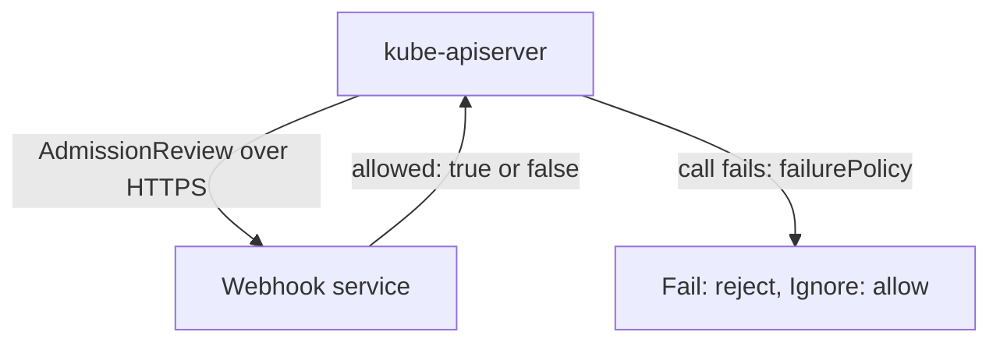

# Policy Engines And Admission Webhooks

The built-in policy checks a string. Some image rules need more: look up a signature, call an external scanner or mutate a pod to add a digest. For those rules, the API server calls an admission webhook, and engines such as Kyverno and OPA Gatekeeper are webhooks with a policy language on top. A webhook is also a service that can be down, and its failure setting decides whether the cluster stays protected or stays available. This part explains the webhook mechanism, compares the engines and tests what happens when a webhook is unreachable.

## How a webhook is called

A webhook is registered with a ValidatingWebhookConfiguration or a MutatingWebhookConfiguration object. Each entry in its `webhooks` list defines:

- `rules`: the API groups, resources and operations that trigger a call.
- `clientConfig`: where to send the call, either a `service` in the cluster or a `url`, and a `caBundle`, the certificate authority (CA) certificate that the API server uses to verify the webhook's TLS certificate.
- `failurePolicy`: `Fail` rejects the request when the call fails (timeout, connection error, certificate error), and `Ignore` lets the request through. The default is `Fail`.
- `timeoutSeconds`: how long the API server waits, from 1 to 30 seconds, with a default of 10.
- `namespaceSelector` and `objectSelector`: filters that skip matching namespaces or objects.
- `sideEffects` and `admissionReviewVersions`: required fields. `None` states that the webhook does not change anything outside the request, which makes dry-run requests safe.

The API server sends an `AdmissionReview` JSON document that contains the object, and the webhook answers with `allowed: true` or `false` and an optional message. A mutating webhook can also return a JSON patch.



The diagram shows that a failed call falls back to the `failurePolicy` setting and not to the webhook's own logic.

The trade-off is simple. With `Fail`, an outage of the webhook blocks every matching request, including the pods of the webhook itself and system components, unless the namespace is excluded. With `Ignore`, an attacker who can make the webhook fail (by overload or by a network change) bypasses the rule. Security rules normally use `Fail`, and the webhook runs with several replicas, and the namespace of the webhook is excluded from its own rules.

## The common engines

All of these enforce image rules at admission. They differ in language and in what else they can do.

- **ValidatingAdmissionPolicy** uses CEL, runs inside the API server, has no extra service and can only validate (a MutatingAdmissionPolicy exists for mutation in newer releases). It cannot call outside services, so it cannot verify a signature.
- **Kyverno** is a policy engine whose policies are Kubernetes YAML (`ClusterPolicy` and `Policy`). It can validate, mutate (for example, rewrite a tag to a digest), generate resources and verify image signatures and attestations with its `verifyImages` rule.
- **OPA Gatekeeper** runs policies written in Rego, the language of Open Policy Agent (OPA). You define a `ConstraintTemplate`, which contains the Rego and creates a new constraint kind, and then you create constraints of that kind with parameters.
- **ImagePolicyWebhook** delegates the decision to an external service of your own, and its configuration lives in the API server files, not in the cluster API.

The playground does not install Kyverno or Gatekeeper, so the two policies below are for reading. A Kyverno policy that allows only two registries looks like this:

```yaml
apiVersion: kyverno.io/v1
kind: ClusterPolicy
metadata:
  name: restrict-registries
spec:
  validationFailureAction: Enforce
  rules:
    - name: allowed-registries
      match:
        any:
          - resources:
              kinds: ["Pod"]
      validate:
        message: "images must come from docker.io/library/ or registry.k8s.io/"
        pattern:
          spec:
            containers:
              - image: "docker.io/library/* | registry.k8s.io/*"
```

In newer Kyverno releases the enforcement setting moves from the policy to the rule, so read the field names of the version you install. The same rule in Gatekeeper uses a template with Rego and a constraint with the allowed repositories as a parameter:

```yaml
apiVersion: templates.gatekeeper.sh/v1
kind: ConstraintTemplate
metadata:
  name: k8sallowedrepos
spec:
  crd:
    spec:
      names:
        kind: K8sAllowedRepos
      validation:
        openAPIV3Schema:
          type: object
          properties:
            repos:
              type: array
              items:
                type: string
  targets:
    - target: admission.k8s.gatekeeper.sh
      rego: |
        package k8sallowedrepos
        violation[{"msg": msg}] {
          container := input.review.object.spec.containers[_]
          not strings.any_prefix_match(container.image, input.parameters.repos)
          msg := sprintf("container <%v> has an invalid image repo <%v>", [container.name, container.image])
        }
```

A constraint of the kind `K8sAllowedRepos` then lists the `repos` and the kinds it applies to. This template checks only `containers`, so a complete one also loops over init containers.

## Test an unreachable webhook

You can see the failure behaviour in the playground with a webhook configuration that points at a Service which does not exist. It applies only to pods in one labelled namespace, so no other workload is affected. Select the playground cluster:

<!-- astrona:playground:renew -->

```sh
export KUBECONFIG="$(astrona kubeconfig ats-035-playground-030-01)"
test "$(kubectl config current-context)" = "kind-astro-ats-035-playground-030-01" || exit 1
```

Save this as `webhook-unreachable.yaml`:

```yaml
apiVersion: v1
kind: Namespace
metadata:
  name: webhook-demo
  labels:
    training.astrona.io/demo-webhook: enabled
---
apiVersion: admissionregistration.k8s.io/v1
kind: ValidatingWebhookConfiguration
metadata:
  name: unreachable-demo
webhooks:
  - name: unreachable.demo.example
    admissionReviewVersions: ["v1"]
    sideEffects: None
    timeoutSeconds: 5
    failurePolicy: Fail
    clientConfig:
      service:
        name: missing
        namespace: webhook-demo
        path: /validate
        port: 443
    rules:
      - apiGroups: [""]
        apiVersions: ["v1"]
        operations: ["CREATE"]
        resources: ["pods"]
    namespaceSelector:
      matchLabels:
        training.astrona.io/demo-webhook: enabled
```

Apply it:

```sh
kubectl apply -f webhook-unreachable.yaml
```

Save this pod as `pod-webhook-test.yaml` and send it through admission as a dry run:

```yaml
apiVersion: v1
kind: Pod
metadata:
  name: webhook-test
  namespace: webhook-demo
spec:
  containers:
    - name: app
      image: docker.io/library/busybox:1.37.0
      command: ["sh", "-c", "sleep 3600"]
```

```sh
kubectl apply --dry-run=server -f pod-webhook-test.yaml
```

The request fails. The error says that a call to the webhook `unreachable.demo.example` failed, and it names the missing Service. The API server did the check and applied `failurePolicy: Fail`. Now change the policy to `Ignore` and repeat the request:

```sh
kubectl patch validatingwebhookconfiguration unreachable-demo --type=json -p '[{"op":"replace","path":"/webhooks/0/failurePolicy","value":"Ignore"}]'
kubectl apply --dry-run=server -f pod-webhook-test.yaml
```

The pod is now accepted, although the webhook never answered. If this webhook enforced a security rule, the rule would be off. Clean up:

```sh
kubectl delete -f webhook-unreachable.yaml
```

You now know how webhooks are called, what `failurePolicy` does when they are down, and how the engines differ. None of them yet checks that an image content was published by a trusted party. The next part adds that check with signatures.

## Common pitfalls

> [!WARNING]
> - **Using `failurePolicy: Ignore` on a security webhook.** An outage or an attack on the webhook turns the rule off without any visible error.
> - **Using `Fail` without excluding the webhook's own namespace.** If the webhook pods are rejected, the webhook cannot start and the cluster cannot recover without editing the configuration.
> - **Excluding broad namespaces.** A namespace in `namespaceSelector` exceptions is outside the rule, and anyone who can label a namespace can place it there.
> - **Forgetting init containers in a custom rule.** A template that loops only over `containers` misses the other lists.
> - **Choosing CEL for a rule that needs a signature lookup.** CEL cannot call out of the API server.
