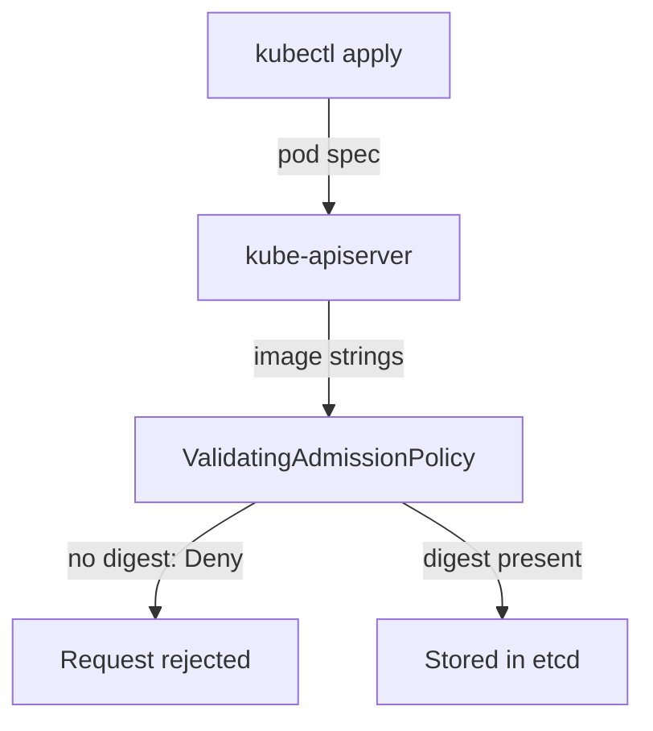

# A Digest Rule With ValidatingAdmissionPolicy

A pod that names its image by tag runs whatever the tag points to when the node pulls it. The same manifest can run different content on two nodes, or on the same node a week later. This part writes an admission rule that rejects any image that is not named by its digest, tests the rule without creating a pod, and then enforces it.

## What a digest reference looks like

A digest is the SHA-256 hash of the image manifest. In a pod it is written after an `@` sign: `docker.io/library/busybox@sha256:` followed by 64 lowercase hexadecimal characters. A reference can also keep the tag for people to read, as in `busybox:1.37.0@sha256:<digest>`. The container runtime then uses the digest and ignores the tag.

The API server does not pull images, so it cannot check that a digest exists. It can only check the text of the reference. CEL (Common Expression Language) is the expression language of ValidatingAdmissionPolicy, and its `matches` function tests a string against a regular expression. The expression `i.matches('@sha256:[a-f0-9]{64}$')` is true when a string ends with `@sha256:` and exactly 64 hexadecimal characters. The `$` at the end matters: without it, extra text after the digest would pass.



The diagram shows that the policy runs inside the API server, before the pod is stored, so a rejected pod never reaches a node.

## Write the rule in warning mode

The rule must look at three lists, `containers`, `initContainers` and `ephemeralContainers`, because each one runs code. A variable collects all image strings, so the validation is written once. Select the playground cluster first:

<!-- astrona:playground:renew -->

```sh
export KUBECONFIG="$(astrona kubeconfig ats-035-playground-030-02)"
test "$(kubectl config current-context)" = "kind-astro-ats-035-playground-030-02" || exit 1
```

Save this as `digest-demo-policy.yaml`:

```yaml
apiVersion: v1
kind: Namespace
metadata:
  name: digest-demo
  labels:
    training.astrona.io/digest-demo: enabled
---
apiVersion: admissionregistration.k8s.io/v1
kind: ValidatingAdmissionPolicy
metadata:
  name: digest-demo
spec:
  failurePolicy: Fail
  matchConstraints:
    resourceRules:
      - apiGroups: [""]
        apiVersions: ["v1"]
        operations: ["CREATE", "UPDATE"]
        resources: ["pods"]
  variables:
    - name: images
      expression: >-
        object.spec.containers.map(c, c.image) +
        (has(object.spec.initContainers) ? object.spec.initContainers.map(c, c.image) : []) +
        (has(object.spec.ephemeralContainers) ? object.spec.ephemeralContainers.map(c, c.image) : [])
  validations:
    - expression: "variables.images.all(i, i.matches('@sha256:[a-f0-9]{64}$'))"
      message: "every image must be referenced by digest"
---
apiVersion: admissionregistration.k8s.io/v1
kind: ValidatingAdmissionPolicyBinding
metadata:
  name: digest-demo
spec:
  policyName: digest-demo
  validationActions: ["Warn", "Audit"]
  matchResources:
    namespaceSelector:
      matchLabels:
        training.astrona.io/digest-demo: enabled
```

Apply it:

```sh
kubectl apply -f digest-demo-policy.yaml
```

Then check that the API server type-checked the expressions. An empty result means it found no problem:

```sh
kubectl get validatingadmissionpolicy digest-demo -o jsonpath='{.status.typeChecking}{"\n"}'
```

## Test with server-side dry runs

A server-side dry run sends the request through the whole admission chain and stores nothing. Save a pod that names its image by tag only as `pod-tag-only.yaml`:

```yaml
apiVersion: v1
kind: Pod
metadata:
  name: tag-only
  namespace: digest-demo
spec:
  containers:
    - name: app
      image: docker.io/library/busybox:1.37.0
      command: ["sh", "-c", "sleep 3600"]
```

Save a second pod that adds a digest as `pod-pinned.yaml`. The digest below is a made-up value of 64 letters `a`. A dry run does not pull the image, so the value is enough to test the rule:

```yaml
apiVersion: v1
kind: Pod
metadata:
  name: pinned
  namespace: digest-demo
spec:
  containers:
    - name: app
      image: docker.io/library/busybox:1.37.0@sha256:aaaaaaaaaaaaaaaaaaaaaaaaaaaaaaaaaaaaaaaaaaaaaaaaaaaaaaaaaaaaaaaa
      command: ["sh", "-c", "sleep 3600"]
```

Send both through admission:

```sh
kubectl apply --dry-run=server -f pod-tag-only.yaml
kubectl apply --dry-run=server -f pod-pinned.yaml
```

The first request is accepted and prints a `Warning:` line with the policy message, because the binding only has `Warn` and `Audit`. The second request prints no warning. The `Audit` action adds an audit annotation to the API server audit event; a `kind` cluster does not write an audit log by default, so you see only the warning here.

## Enforce the rule

When the warnings list only the pods you expected, change the action to `Deny`:

```sh
kubectl patch validatingadmissionpolicybinding digest-demo --type=json -p '[{"op":"replace","path":"/spec/validationActions","value":["Deny"]}]'
```

Wait a few seconds for the binding to take effect, then repeat the first dry run:

```sh
kubectl apply --dry-run=server -f pod-tag-only.yaml
```

The request now fails with an error from the API server that names the policy `digest-demo`, the binding and your message. The pinned pod is still accepted. Remove the demo objects:

```sh
kubectl delete -f digest-demo-policy.yaml
```

You can now require digests at admission and roll the rule out in three steps. A digest rule has a gap: it proves that the author wrote some digest, and it does not prove that the digest belongs to a trusted build. Signatures close that gap, and the next part shows what a signature is.

## Common pitfalls

> [!WARNING]
> - **Leaving out the `$` in the regular expression.** Text after the digest then still passes the rule.
> - **Checking only `containers`.** Init containers and ephemeral containers run code too.
> - **Treating a digest as proof of trust.** A digest names bytes. The rule cannot tell whether a trusted party built them.
> - **Expecting a Deployment to be rejected.** The rule matches pods, so the Deployment is admitted and its ReplicaSet fails to create pods. Read the events.
> - **Going straight to `Deny`.** Run `Warn` and `Audit` first and read what would break.
