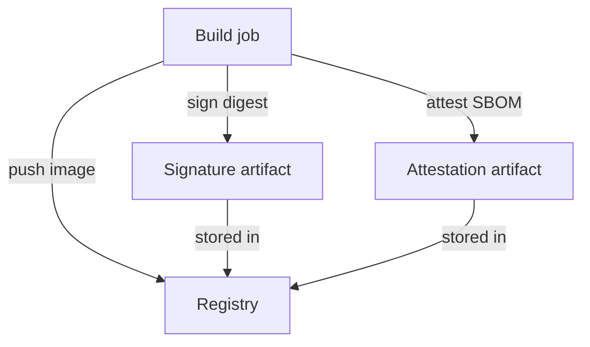

# Signatures, Attestations And Keyless Signing

A digest tells you which bytes will run. It does not tell you who built them. Anyone who can push to a registry can push content and compute its digest. A signature adds the missing fact: a named signer states that this digest is theirs. This part explains what a signature and an attestation are, where they are stored, and how key-based and keyless signing differ in what a verifier must trust.

## What is stored in the registry

Cosign is the signing tool of the Sigstore project. When cosign signs an image, it does not change the image. It signs the digest of the image manifest and uploads the result as a separate OCI artifact in the same repository. In the common layout, the signature artifact is tagged with the image digest, with the colon replaced by a dash, followed by `.sig`. A verifier therefore needs only the image reference and the registry.

An attestation is a signed statement about an image, in a format called in-toto. The statement has a subject (the image digest), a predicate type that says what the statement is, and the predicate itself. Typical predicates are a software bill of materials (SBOM), a vulnerability scan result and SLSA build provenance, which records which source and which build system produced the image. Cosign stores attestations beside the signature in the same way.



The diagram shows that the signature and the attestation are objects in the registry, linked to the image by its digest. A tag that moves later does not carry a signature along, because the signature belongs to the digest.

## Key-based signing

In key-based signing, the owner creates a key pair. The private key signs, and the public key verifies. A verifier that holds the public key accepts a signature only when it matches that key.

The strength of this model is its simplicity: the verifier trusts one public key and needs no network service. The cost is key management. The private key must be stored safely, rotated, and replaced everywhere when it leaks. Anyone who steals the private key can sign any image as the owner. These cosign commands run on your own machine and not in the cluster; replace the placeholders with your values:

```sh
cosign generate-key-pair
cosign sign --key cosign.key <REGISTRY>/<REPOSITORY>@sha256:<DIGEST>
cosign verify --key cosign.pub <REGISTRY>/<REPOSITORY>@sha256:<DIGEST>
```

The first command writes `cosign.key` and `cosign.pub`. The second command signs the digest and uploads the signature. The third command downloads the signature, checks it against the public key and compares the signed digest with the digest you gave.

## Keyless signing

Keyless signing removes the long-lived private key. The signer proves its identity to an OIDC (OpenID Connect) provider, for example the identity of a CI workflow. Fulcio, the Sigstore certificate authority, issues a short-lived certificate that binds a fresh public key to that identity. The signer signs the digest, discards the key and records the signing event in Rekor, the Sigstore transparency log. A transparency log is an append-only public record that anyone can search and audit.

The verifier cannot trust a key, because no key lasts. It trusts an identity instead, and it must state two values: the certificate identity (who signed, for example a workflow path in a repository) and the OIDC issuer (which provider vouched for that identity). The command has this form:

```sh
cosign verify \
  --certificate-identity <IDENTITY> \
  --certificate-oidc-issuer <ISSUER> \
  <REGISTRY>/<REPOSITORY>@sha256:<DIGEST>
```

The command checks the certificate chain, checks that the identity and the issuer match your values, and checks that the signing event is in the transparency log. A verification that accepts any identity proves only that someone signed the image. Always name the identity and the issuer.

## Try it in the playground

The cluster does not hold cosign signatures, but you can practise the first step of every verification: reading the exact content that a pod runs. Select the playground and read the digest that the container runtime reported for the `shuttle` pod:

<!-- astrona:playground:renew -->

```sh
export KUBECONFIG="$(astrona kubeconfig ats-035-playground-030-02)"
test "$(kubectl config current-context)" = "kind-astro-ats-035-playground-030-02" || exit 1
kubectl -n starfleet get pod shuttle -o jsonpath='{.status.containerStatuses[0].imageID}{"\n"}'
```

If the field shows the repository form, the part after `@` is the digest to give to `cosign verify`. If the node loaded the image from an archive, the field can show an image identifier without a repository name; in that case the registry holds the digest you would verify. Verify the digest of the running content, never a tag, because a tag could point to a different image than the one that runs.

You now know what a signature proves and what a verifier must be told. The open question is who runs the verification when a pod is created, since the API server cannot do it with CEL alone.

## Common pitfalls

> [!WARNING]
> - **Verifying a tag.** Resolve the tag to a digest and verify the digest, then run the digest.
> - **Accepting any keyless identity.** Without `--certificate-identity` and `--certificate-oidc-issuer`, any signer passes.
> - **Treating a signature as a safety statement.** A signature says who vouches for the content. It says nothing about vulnerabilities.
> - **Leaving a private key in the build system.** A stolen key signs anything. Prefer short-lived keyless identities or a key in a protected service.
