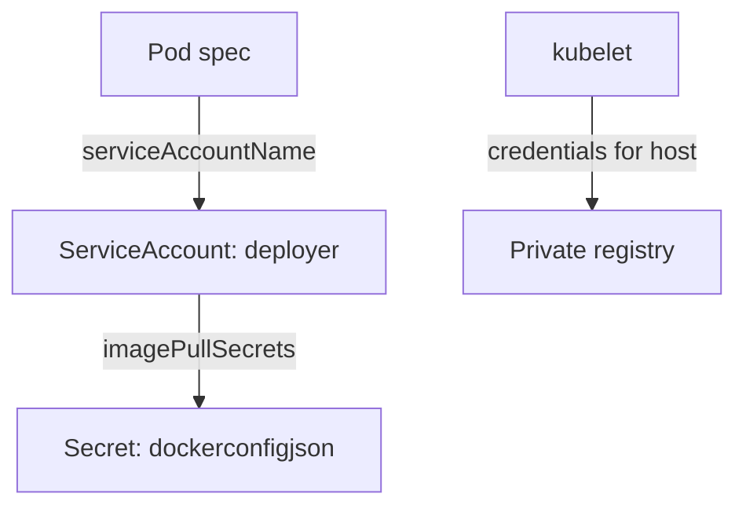

# Pull Credentials For Private Registries

A permitted-registries rule often points at a private registry, and a private registry refuses a pull without credentials. If the cluster cannot pull the approved image, the pod stays in `ImagePullBackOff`. This part shows how Kubernetes stores registry credentials, how a pod receives them, and what to watch for when you hand them out.

## A Secret of type dockerconfigjson

A registry credential is stored in a Secret of type `kubernetes.io/dockerconfigjson`. The Secret has one key, `.dockerconfigjson`, whose value is a JSON document in the same format as the Docker client configuration file. The document maps a registry host name to a user name, a password and an `auth` value, which is the base64 encoding of `user:password`.

The kubelet is the node agent that starts containers. When it must pull an image, it takes the registry host from the image reference, looks for a matching entry in the pod's `imagePullSecrets` and sends the credentials with the pull request. A pod lists the Secrets in `spec.imagePullSecrets`. A ServiceAccount can list them too, and the ServiceAccount admission plugin copies the list into every pod that uses the account and has no list of its own.



The diagram shows that the pod reaches the Secret through its ServiceAccount, and that the kubelet, not the container, presents the credentials to the registry.

## Create and attach the credentials

Select the playground and create a namespace for the exercise. The registry `registry.example.com` does not exist, and the playground never pulls from it, so the values are examples:

<!-- astrona:playground:renew -->

```sh
export KUBECONFIG="$(astrona kubeconfig ats-035-playground-030-03)"
test "$(kubectl config current-context)" = "kind-astro-ats-035-playground-030-03" || exit 1
kubectl create namespace pull-demo
```

Create the Secret with the `docker-registry` form of `kubectl create secret`, which builds the JSON document for you:

```sh
kubectl -n pull-demo create secret docker-registry registry-credentials \
  --docker-server=registry.example.com \
  --docker-username=reader \
  --docker-password=example-pass
```

Check the type and decode the key to see its structure:

```sh
kubectl -n pull-demo get secret registry-credentials -o jsonpath='{.type}{"\n"}'
kubectl -n pull-demo get secret registry-credentials -o jsonpath='{.data.\.dockerconfigjson}' | base64 -d
```

The first command prints `kubernetes.io/dockerconfigjson`. The second prints a JSON document with an `auths` object that has one entry for `registry.example.com`. The password is readable by anyone who may read the Secret, so base64 is an encoding and not protection.

Now attach the Secret to a ServiceAccount. Save this as `serviceaccount-puller.yaml`:

```yaml
apiVersion: v1
kind: ServiceAccount
metadata:
  name: puller
  namespace: pull-demo
imagePullSecrets:
  - name: registry-credentials
```

Apply it:

```sh
kubectl apply -f serviceaccount-puller.yaml
```

Then check that a pod that uses the account receives the Secret. Save a pod as `pod-puller.yaml`:

```yaml
apiVersion: v1
kind: Pod
metadata:
  name: puller-test
  namespace: pull-demo
spec:
  serviceAccountName: puller
  containers:
    - name: app
      image: docker.io/library/busybox:1.37.0
      command: ["sh", "-c", "sleep 3600"]
```

Send it through admission without storing it, and read the field that the ServiceAccount admission plugin added:

```sh
kubectl apply --dry-run=server -f pod-puller.yaml -o jsonpath='{.spec.imagePullSecrets}{"\n"}'
```

The output lists `registry-credentials`, although the pod file does not mention it. Remove the exercise namespace:

```sh
kubectl delete namespace pull-demo
```

You can now store and distribute registry credentials. The pull side is only half of the control, and these credentials are a target for an attacker, so the next section lists the risks.

## Risks and safer options

A pull secret gives read access to a registry. Anyone who can read the Secret, or who can create a pod in the namespace and mount or reference it, can reuse the credentials. Keep these rules:

- Give the registry account read-only access to the repositories the namespace needs.
- Restrict `get` and `list` on Secrets with RBAC (role-based access control).
- Use one Secret per namespace or per team, so a leak has a small scope.
- Prefer short-lived credentials from a node-level credential provider (a kubelet plugin that fetches tokens from a cloud registry), because a node-level token is not stored as a Secret.

## Common pitfalls

> [!WARNING]
> - **Creating the Secret in the wrong namespace.** A pod can only reference Secrets from its own namespace.
> - **Using the wrong type.** A generic Secret with the right key is not accepted for pulls. Use `kubernetes.io/dockerconfigjson`.
> - **Matching the wrong host.** The registry host in the Secret must match the host in the image reference.
> - **Treating base64 as encryption.** Anyone who can read the Secret can decode it.
> - **Sharing one broad credential across the cluster.** A leak then exposes every repository the account can read.
