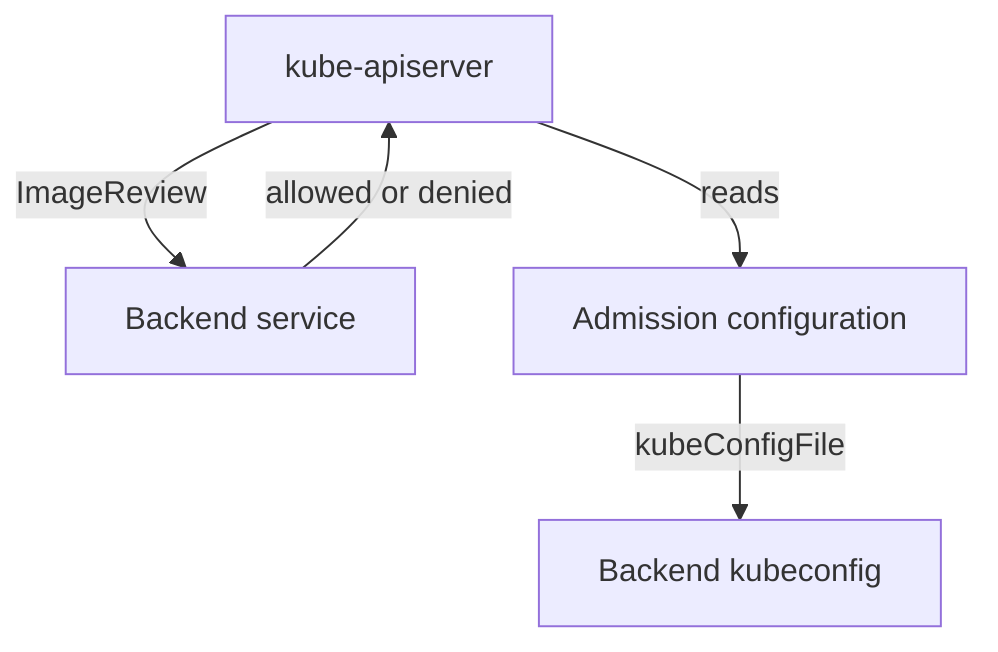

# The ImagePolicyWebhook Admission Plugin

Some clusters decide which images may run with an external service. The API server has a built-in way to ask such a service: the ImagePolicyWebhook admission plugin. It is not enabled by default and it needs files on the control plane node. This part shows what the plugin sends, which files configure it, and why the `defaultAllow` setting decides whether an outage blocks pods or lets everything through.

## What the plugin does

When a pod is created, the plugin builds an `ImageReview` object. It holds the container images, the namespace and the pod annotations. The plugin sends the review as an HTTPS request to a backend, which is a service that you run. The backend answers with `allowed: true` or `allowed: false` and an optional reason. If the backend answers `false`, the API server rejects the pod.

The plugin runs on the API server host, so its configuration is not a Kubernetes object. It needs three things on the control plane node:

- The flag `--enable-admission-plugins` in the kube-apiserver arguments must include `ImagePolicyWebhook`.
- The flag `--admission-control-config-file` must point to an admission configuration file.
- The admission configuration file points to a kubeconfig file that holds the backend address and the client credentials.



The diagram shows that the API server asks the backend about every new pod, and that two files on the node tell it where the backend is.

## The configuration file

The admission configuration file has this form. The values are examples:

```yaml
apiVersion: apiserver.config.k8s.io/v1
kind: AdmissionConfiguration
plugins:
  - name: ImagePolicyWebhook
    configuration:
      imagePolicy:
        kubeConfigFile: /etc/kubernetes/admission/backend.kubeconfig
        allowTTL: 50
        denyTTL: 50
        retryBackoff: 500
        defaultAllow: false
```

The fields mean this. `kubeConfigFile` is the path of the backend kubeconfig on the node. `allowTTL` and `denyTTL` are the number of seconds the API server caches an allow or deny answer. `retryBackoff` is the wait in milliseconds before a retry. `defaultAllow` decides what happens when the backend cannot be reached: `true` admits the pod, and `false` rejects it.

The setting `defaultAllow: true` makes the plugin fail open. When the backend is down, slow or unreachable, every pod is admitted and no one sees an error. A security control should use `defaultAllow: false`, and the cluster then needs a backend with several replicas, because an outage blocks new pods.

The API server runs as a static pod, so the node directory that holds the two files must also be mounted into the static pod with a volume in its manifest. A mistake in this file can stop the API server from starting, so edit with care and keep a copy of the original manifest.

## Look at the playground control plane

The playground does not enable the plugin, and you should not change the control plane of the playground. You can read the settings that decide whether it is on. The playground runs the control plane in a `kind` node container, so you read the static pod manifest with the container engine:

<!-- astrona:playground:renew -->

```sh
export KUBECONFIG="$(astrona kubeconfig ats-035-playground-030-03)"
test "$(kubectl config current-context)" = "kind-astro-ats-035-playground-030-03" || exit 1
node_name="astro-ats-035-playground-030-03-control-plane"
podman exec "$node_name" grep -n 'admission' /etc/kubernetes/manifests/kube-apiserver.yaml
```

The command prints every line of the kube-apiserver manifest that mentions admission. A line with `--enable-admission-plugins` lists plugins that are enabled in addition to the defaults. If `ImagePolicyWebhook` is not in the list, the plugin is off and no image review is sent. If the command prints nothing, the manifest has no admission flags and the defaults apply.

The command targets only the container of this playground. You can also ask the running API server which admission plugins its flags enable, by reading the pod in the `kube-system` namespace:

```sh
kubectl -n kube-system get pod -l component=kube-apiserver -o jsonpath='{.items[0].spec.containers[0].command}{"\n"}'
```

Search the output for `enable-admission-plugins`. A cluster that relies on ImagePolicyWebhook shows the plugin name and an `admission-control-config-file` flag here. You can use the same check in an audit of a cluster you are given.

You now know how the plugin is wired and why the flags and the file matter. The plugin is one example of an admission check that depends on an external service, and the next part compares the ways such a check can stop working.

## Common pitfalls

> [!WARNING]
> - **Setting `defaultAllow: true`.** An unreachable backend then allows every pod.
> - **Enabling the plugin without the configuration file.** The API server cannot start the plugin or fails to start.
> - **Forgetting the volume mount.** The API server pod cannot read files on the node that it does not mount.
> - **Using a single backend replica.** One outage blocks every new pod, or, with `defaultAllow: true`, disables the check.
> - **Editing the manifest without a backup.** A syntax error stops the API server.
