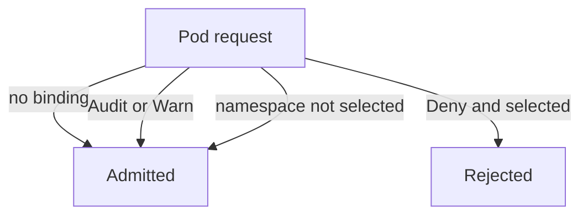

# Admission Failure Modes And Exemptions

An admission check can exist, be visible in the cluster and still allow every bad image. The cause is usually not the rule itself. It is a setting around the rule: an action that only logs, a failure policy that allows on error, or a selector that leaves a namespace out. This part tests each setting on one policy in the playground and then describes the same failure modes for webhooks.

## Four ways a check stops protecting

A policy has to pass four tests before it blocks a bad pod:

1. The policy must have a binding. Without a binding, a ValidatingAdmissionPolicy does nothing.
2. The binding must use `Deny`. The action `Audit` records a violation in the audit log, and `Warn` sends a warning to the client. Neither rejects the request.
3. The binding must select the namespace. A `namespaceSelector` on the binding limits the policy to labelled namespaces, so a missing or removed label exempts the namespace.
4. The check must work when it fails. For a ValidatingAdmissionPolicy, `failurePolicy: Fail` rejects a request when the expression cannot be evaluated, and `Ignore` allows it. For a webhook, `failurePolicy` decides what happens when the service cannot be reached.



The diagram shows that three of the four paths end in admission, and only a binding with `Deny` that selects the namespace rejects the pod.

## Test the actions in the playground

Select the playground cluster first:

<!-- astrona:playground:renew -->

```sh
export KUBECONFIG="$(astrona kubeconfig ats-035-playground-030-03)"
test "$(kubectl config current-context)" = "kind-astro-ats-035-playground-030-03" || exit 1
```

Save this as `failure-demo.yaml`. It holds a namespace, a policy and a binding that only audits:

```yaml
apiVersion: v1
kind: Namespace
metadata:
  name: failure-demo
  labels:
    training.astrona.io/failure-demo: enabled
---
apiVersion: admissionregistration.k8s.io/v1
kind: ValidatingAdmissionPolicy
metadata:
  name: failure-demo
spec:
  failurePolicy: Fail
  matchConstraints:
    resourceRules:
      - apiGroups: [""]
        apiVersions: ["v1"]
        operations: ["CREATE", "UPDATE"]
        resources: ["pods"]
  validations:
    - expression: "object.spec.containers.all(c, c.image.startsWith('docker.io/library/'))"
      message: "image registry is not approved"
---
apiVersion: admissionregistration.k8s.io/v1
kind: ValidatingAdmissionPolicyBinding
metadata:
  name: failure-demo
spec:
  policyName: failure-demo
  validationActions: ["Audit"]
  matchResources:
    namespaceSelector:
      matchLabels:
        training.astrona.io/failure-demo: enabled
```

Apply it:

```sh
kubectl apply -f failure-demo.yaml
```

Save a pod with an image from a registry that the policy does not approve as `pod-unapproved.yaml`:

```yaml
apiVersion: v1
kind: Pod
metadata:
  name: unapproved
  namespace: failure-demo
spec:
  containers:
    - name: app
      image: unapproved.example/tools/app:1.0
      command: ["sh", "-c", "sleep 3600"]
```

Send it through admission once the binding is active, which takes a few seconds:

```sh
kubectl apply --dry-run=server -f pod-unapproved.yaml
```

The request is accepted and prints no warning, because the binding only audits. The violation is recorded only in the audit log, and a `kind` cluster does not write an audit log by default, so here nothing shows the violation. This is the first failure mode: a check that looks present and changes nothing.

Change the action to `Warn` and repeat the dry run. The request is still accepted, and now the client prints a `Warning:` line with the policy message:

```sh
kubectl patch validatingadmissionpolicybinding failure-demo --type=json -p '[{"op":"replace","path":"/spec/validationActions","value":["Warn"]}]'
```

Wait a few seconds and run the dry run again. Then change the action to `Deny`, wait and run it a third time. The third run fails with an error that names the policy and the message:

```sh
kubectl patch validatingadmissionpolicybinding failure-demo --type=json -p '[{"op":"replace","path":"/spec/validationActions","value":["Deny"]}]'
```

## Exemption by label

Now remove the label that makes the namespace match the binding. Anyone who can label a namespace can do this, so the permission to edit namespaces is part of the control:

```sh
kubectl label namespace failure-demo training.astrona.io/failure-demo-
```

Wait a few seconds and run the dry run of `pod-unapproved.yaml` again. The request is accepted, because the binding no longer selects the namespace. Restore the label to enforce the rule again, and clean up:

```sh
kubectl label namespace failure-demo training.astrona.io/failure-demo=enabled
kubectl delete -f failure-demo.yaml
```

## The same failure modes for webhooks

A validating webhook has the same four tests, with different names. The `failurePolicy` field of the webhook configuration decides what happens when the service cannot be reached: `Fail` rejects requests and `Ignore` admits them. The `namespaceSelector` and `objectSelector` fields exclude namespaces and objects. A webhook that excludes `kube-system` is normal, because the webhook service itself must not wait for its own approval. A webhook that excludes more namespaces than it needs leaves them open. The field `timeoutSeconds` bounds the wait, and a timeout is treated as a failure of the webhook, so `failurePolicy` applies.

To check a real cluster, list the configurations and read the failure policy and the selectors of each webhook:

```sh
kubectl get validatingwebhookconfigurations -o custom-columns=NAME:.metadata.name,POLICY:.webhooks[*].failurePolicy
```

The playground has no image webhook, so the list can be empty. You now know the places where a check can be switched off without deleting it, and the order in which to look for them.

## Common pitfalls

> [!WARNING]
> - **Calling an audit-only binding enforcement.** `Audit` and `Warn` never reject a request.
> - **Letting many users label namespaces.** A label that selects the policy is also the way to leave it.
> - **Using `failurePolicy: Ignore` for a security check.** A failure of the service then allows every pod.
> - **Testing only the allowed case.** Always run a request that must be rejected, and expect it to fail.
> - **Forgetting the delay.** A new or changed binding needs a few seconds before it takes effect.
