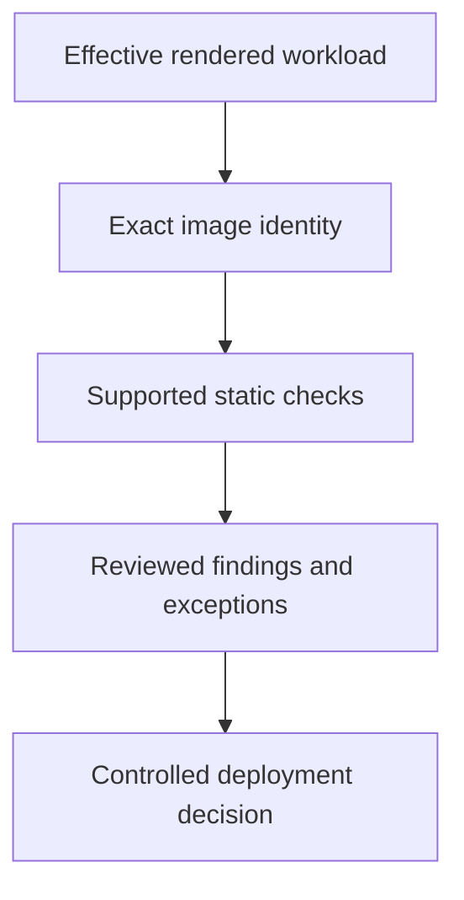

# Static Workload And Image Analysis In A Release Decision

A template appears restricted, but the production overlay adds a writable host mount. Analysis of the source base alone did not evaluate the effective deployment input.

## Learning objectives

- Distinguish manifest linting from vulnerability and runtime assessment.
- Explain how Kubesec and KubeLinter identify risky declarations.
- Bind image findings to artifact identity and scanner evidence.

## Before you start

This chapter is standalone reading material; no running cluster or installed tools are required. A Pod is the Kubernetes unit for running one or more containers, and a namespace groups namespaced objects. Treat the worked configurations as teaching examples rather than recorded observations from a provisioned environment.

## Responsible components and behavior

Static analysis evaluates software or configuration without observing the complete running application's behavior. In a Kubernetes release process, it can identify risky workload declarations and known defects in image contents before deployment. Its value depends on the selected rules, analyzed artifact identity and a policy for interpreting findings.

## Analyze Workload Intent

A workload manifest describes requested identities, privileges, mounts, resources and image references. Static tools can inspect those declarations for risky patterns. A privileged container, writable host mount, missing resource boundary or broad capability can be identified before the API accepts the workload. The finding concerns the declaration and its possible consequences, not proof that a particular attack has occurred.

Kubesec assesses supported resource definitions against security-oriented checks and can present a score with findings. KubeLinter applies checks to Kubernetes configuration and related deployment inputs to identify potential security and reliability issues. Their models and supported checks differ. A numeric score from one tool should not be interpreted as a universal probability that the application is safe.

## Assess The Effective Deployment Input

A chart template or overlay source can differ from the rendered manifest. Analysis should evaluate the configuration that is intended to enter the deployment path, including relevant defaults and environment-specific changes. A secure base declaration can become unsafe after an overlay adds a host mount or changes a security context.

Suppose an application manifest requests privilege only to write a temporary file. A static finding can prompt review of that justification. A narrow writable volume and suitable user permissions may satisfy the requirement without privileged execution. The tool identifies the suspicious declaration; application and runtime knowledge establish the appropriate correction.

## Analyze Exact Image Bytes

Image analysis can identify packages, known vulnerabilities, embedded sensitive material or other supported properties. The analyzed digest matters because a tag can move. A report for yesterday's tag does not automatically cover the bytes pulled today. Record the artifact, scanner version, vulnerability database timing and relevant analysis settings so the finding can be interpreted later.

Known vulnerability findings require applicability review. The affected software version, reachable code, required privileges and available fix influence priority. A scanner can miss unsupported package ecosystems or code not represented in its database. A report with no findings is evidence within the scanner's coverage, not proof of defect-free software.

## Turn Findings Into A Decision

A release policy can fail builds on defined risks, require review of exceptions and preserve analysis evidence alongside the artifact. Exceptions should identify the finding, reason, owner and expiry or reconsideration condition. A permanent broad suppression can hide future meaningful findings, while treating every informational warning as an emergency can make the process unusable.

Admission enforcement can ensure that deployment requests satisfy policy, but it must bind its decision to the artifact and intended declaration. Pipeline checks alone can be bypassed if another path permits unchecked deployment. Conversely, a static policy cannot establish actual runtime enforcement of every accepted field.

## Preserve Complementary Controls

Publisher verification, provenance, least privilege, network restrictions and runtime detection address different risks. Static analysis supports those controls rather than replacing them. Review whether the resulting deployment uses the analyzed bytes and configuration, and retain evidence for later incident or upgrade decisions. The aim is a justified release decision with known limits, not merely an attractive score.

## Work through the decision

Static analysis inspects declarations or software content without observing complete runtime behavior. Render the intended chart or overlay output before evaluating workload settings. Then identify the exact image bytes for component and vulnerability analysis rather than checking a tag's older content.

Tools such as Kubesec and KubeLinter apply their supported checks; a score is not a universal safety probability. Review findings against application requirements and policy, with controlled exceptions and updated issue data. A successful static check can still miss runtime compromise, application logic faults or a different delivery path. Preserve complementary admission and observation controls.

Static findings support a release decision only within their actual input, rule and artifact scope.

Static findings support a release decision only within their actual input, rule and artifact scope.

## Common pitfalls

> [!WARNING]
> Manifest scores and clean vulnerability reports are scoped observations. Analyze rendered deployment input and exact image bytes, and retain complementary runtime and artifact-trust controls.
