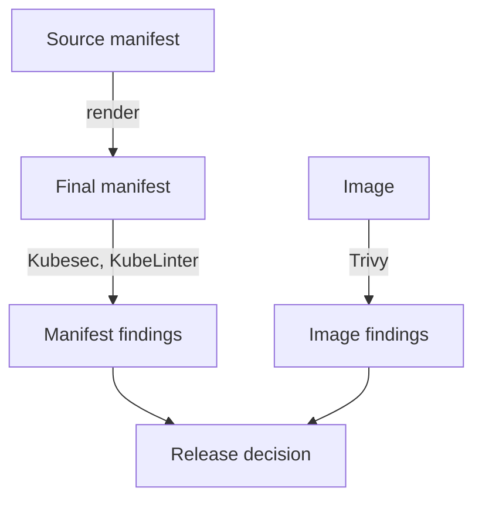

# What Static Analysis Can And Cannot Show

A pod that runs as root or in privileged mode is a risk even if the application inside is correct. Static analysis finds such declarations by reading the manifest, before the pod exists. This part explains what the tools read, why the input must be the final manifest and what a clean report does not prove.

## What a static check reads

A static check parses a YAML or JSON document and tests fields against rules. It does not start a container, call the API server or look at the node. Examples of fields it tests are `securityContext.privileged`, `runAsNonRoot`, `allowPrivilegeEscalation`, `capabilities`, `hostNetwork`, resource limits and the image tag.

Three kinds of static analysis exist, and each answers a different question:

- **Manifest analysis** checks the Kubernetes objects. Kubesec and KubeLinter do this.
- **Image analysis** checks the content of an image for known vulnerable packages, for example with Trivy. It reads the image layers and not the manifest.
- **Dockerfile analysis** checks the build instructions, for example with Hadolint.



The diagram shows that manifest findings and image findings are separate inputs to one decision.

## Why the input must be the final manifest

A source file is not always what the cluster receives. Kustomize overlays, Helm templates and admission mutation change fields after the author wrote them. A scan of the source can miss a privileged setting that a template adds, and it can flag a field that an overlay removes. Scan what will be applied.

The following commands show the difference between what you wrote and what the API server stores. Select the playground cluster:

<!-- astrona:playground:renew -->

```sh
export KUBECONFIG="$(astrona kubeconfig ats-035-playground-040-01)"
test "$(kubectl config current-context)" = "kind-astro-ats-035-playground-040-01" || exit 1
```

Save this as `pod-risky-shuttle.yaml`:

```yaml
apiVersion: v1
kind: Pod
metadata:
  name: risky-shuttle
  namespace: starfleet
spec:
  containers:
    - name: app
      image: docker.io/library/busybox:latest
      command: ["sh", "-c", "sleep 3600"]
      securityContext:
        privileged: true
```

Send it through the API server as a server-side dry run and print the object that the API server would store. The pod is not created:

```sh
kubectl apply --dry-run=server -o yaml -f pod-risky-shuttle.yaml
```

The printed object contains fields you did not write, such as `dnsPolicy`, `restartPolicy`, `serviceAccountName` and the token volume. These defaults come from the API server and its admission plugins. A scanner that reads only your file does not see them. For Kustomize, `kubectl kustomize <folder>` prints the rendered result, and for Helm, `helm template <release> <chart>` does the same. Pipe the output to the scanner.

## What a clean report does not prove

A static report describes declarations. It cannot see:

- what the code inside the container does after it starts;
- vulnerabilities that were published after the scan;
- settings that the cluster applies at run time, such as a missing NetworkPolicy;
- whether the scanned manifest is the one that was deployed.

A score or a count of findings is a measure of declared risk. It is not a measure of safety. A manifest with no findings can still run a vulnerable image, and a manifest with findings can be an accepted exception. This is why a release decision uses several inputs and a record of who accepted what.

You now know what manifest, image and Dockerfile analysis check, why the rendered manifest is the right input, and what a clean report leaves open. The next part uses a named tool, Kubesec, to score a manifest.

## Common pitfalls

> [!WARNING]
> - **Scanning the template and not the output.** Overlays and templates change the final fields.
> - **Treating a clean report as proof of safety.** Static tools do not see run-time behaviour or new vulnerabilities.
> - **Treating manifest analysis as image analysis.** A manifest scan does not look inside the image.
> - **Scanning once.** Scan on every change, and scan images again later, because new vulnerabilities appear.
