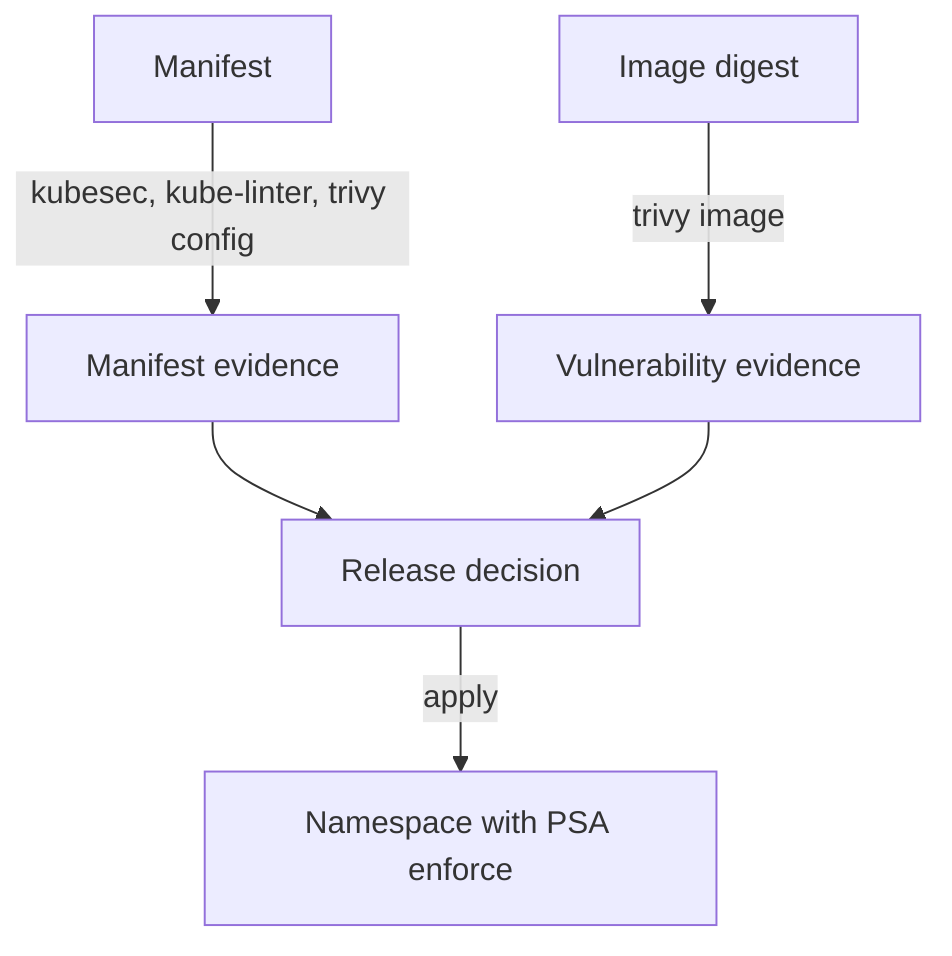

# A Release Decision With Image Scans And Pod Security Admission

A release decision joins three kinds of evidence: manifest findings, image findings and cluster enforcement. Each tool answers a different question, and none of them replaces the others. This part scans the image, scans the manifest with Trivy, writes a manifest that passes the strictest Pod Security Admission level and tests the cluster's own check.

## Three questions, three tools

- **Is the manifest risky?** Kubesec and KubeLinter read the declared fields.
- **Does the image contain known vulnerabilities?** Trivy reads the image packages and compares them with vulnerability databases. `trivy image <image>` scans an image, and `--severity HIGH,CRITICAL` limits the report. `--exit-code 1` makes the command fail when it finds a matching vulnerability.
- **Will the cluster accept it?** Pod Security Admission (PSA) is the built-in admission plugin that enforces the Pod Security Standards: `privileged`, `baseline` and `restricted`. A namespace label sets the level.

Trivy also reads manifests. The command `trivy config <folder>` checks Kubernetes YAML, Dockerfiles and infrastructure files against misconfiguration rules, with identifiers that begin with `KSV` for Kubernetes. It is a third manifest scanner, useful when a pipeline already runs Trivy for images.



The diagram shows that the decision uses both evidence types and that the namespace label is a second, independent check.

## Scan the image and the manifest

These commands run on your machine. Scan the image by name, then scan a folder that holds the manifest:

<!-- astrona:playground:renew -->

```sh
trivy image --severity HIGH,CRITICAL docker.io/library/busybox:1.37.0
trivy config .
```

The first command prints a table of vulnerabilities per package, or states that none matched the severity filter. The result depends on the database at scan time, so a scan today and a scan next month can differ. For this reason, record the image digest, the scanner version and the date with the result. The second command reports misconfigurations in the files of the folder.

## Test the cluster check with a restricted namespace

Select the playground cluster:

```sh
export KUBECONFIG="$(astrona kubeconfig ats-035-playground-040-01)"
test "$(kubectl config current-context)" = "kind-astro-ats-035-playground-040-01" || exit 1
```

Save this as `namespace-release-check.yaml`. The labels make PSA reject pods that do not meet the `restricted` level and warn about them:

```yaml
apiVersion: v1
kind: Namespace
metadata:
  name: release-check
  labels:
    pod-security.kubernetes.io/enforce: restricted
    pod-security.kubernetes.io/warn: restricted
```

Apply it:

```sh
kubectl apply -f namespace-release-check.yaml
```

Save this as `pod-privileged-shuttle.yaml`:

```yaml
apiVersion: v1
kind: Pod
metadata:
  name: privileged-shuttle
  namespace: release-check
spec:
  containers:
    - name: app
      image: docker.io/library/busybox:1.37.0
      command: ["sh", "-c", "sleep 3600"]
      securityContext:
        privileged: true
```

Apply it and read the error:

```sh
kubectl apply -f pod-privileged-shuttle.yaml
```

The API server rejects the pod. The error says that the pod violates PodSecurity `restricted`, and it lists the failed controls, such as privilege escalation, capabilities, `runAsNonRoot` and the seccomp profile. The component that decided is the PSA admission plugin in the API server, and no node saw the pod.

Now save a pod that meets the `restricted` level as `pod-compliant-shuttle.yaml`:

```yaml
apiVersion: v1
kind: Pod
metadata:
  name: compliant-shuttle
  namespace: release-check
spec:
  securityContext:
    runAsNonRoot: true
    runAsUser: 10001
    seccompProfile:
      type: RuntimeDefault
  containers:
    - name: app
      image: docker.io/library/busybox:1.37.0
      command: ["sh", "-c", "sleep 3600"]
      securityContext:
        allowPrivilegeEscalation: false
        readOnlyRootFilesystem: true
        capabilities:
          drop: ["ALL"]
```

Apply it, then check the result:

```sh
kubectl apply -f pod-compliant-shuttle.yaml
kubectl -n release-check get pod compliant-shuttle
```

The pod is accepted and starts. You can also test a label change before you make it. This server-side dry run reports which existing pods in a namespace would violate a stricter level, without changing the namespace:

```sh
kubectl label --dry-run=server --overwrite namespace starfleet pod-security.kubernetes.io/enforce=restricted
```

The API server prints warnings for pods in `starfleet` that would not pass. Clean up:

```sh
kubectl delete namespace release-check
```

## Make the decision

A sound decision records the evidence and the exceptions. Pass the release when the image digest has no accepted-severity vulnerabilities, the manifest has no critical findings, and the target namespace enforces the level the workload meets. Block it when any input fails without an approved exception. Passing every static tool does not prove safety, so run-time controls still apply.

You now know how image findings, manifest findings and Pod Security Admission fit into one release decision, and that each answers a separate question.

## Common pitfalls

> [!WARNING]
> - **Scanning the tag and deploying another image.** Scan and deploy the same digest.
> - **Reading an old scan as current.** Vulnerability data changes. Record the date and scan again.
> - **Using only `warn` mode and expecting enforcement.** `warn` and `audit` do not reject pods. Use `enforce`.
> - **Setting `runAsNonRoot` without a numeric user when the image runs as root.** The pod fails to start. Set `runAsUser` or fix the image.
> - **Letting one tool decide alone.** Combine manifest, image and cluster evidence.
