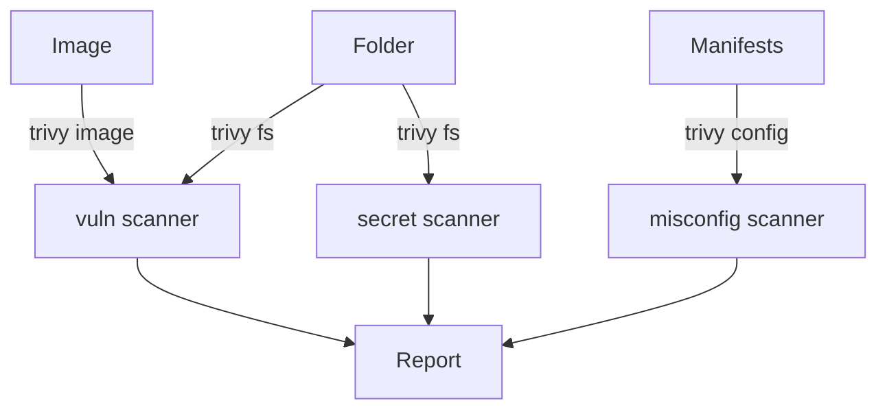

# What Trivy Scans: Images, Folders And Configuration

Two teams can both say "we scan with Trivy" and check completely different things. One scans the image that was built, and the other scans only the Kubernetes manifests. Each command reads a different input and applies a different set of rules. This part names the three commands, the scanners behind them, and the JSON report that the later parts use.

## Three commands, three inputs

Trivy has one command for each kind of input:

- `trivy image <name>` pulls or reads a container image and scans its operating system packages and application dependencies for known vulnerabilities.
- `trivy fs <folder>` scans a folder on disk, such as a source repository. It reads lock files (for example `go.sum` or `package-lock.json`) for vulnerable dependencies and looks for secrets.
- `trivy config <folder>` scans configuration files, such as Kubernetes manifests, Dockerfiles and Terraform, for misconfigurations.

A **scanner** is one kind of check inside Trivy. The `vuln` scanner compares package versions with a vulnerability database. The `misconfig` scanner applies rules to configuration. The `secret` scanner looks for credentials in files. The `--scanners` flag selects which of them run, for example `--scanners vuln,misconfig`.



The diagram shows that several inputs end in one report format. The report is the evidence that a gate reads.

## Vulnerabilities, misconfigurations and secrets

A **vulnerability** is a known flaw in a specific package version, identified by a CVE (Common Vulnerabilities and Exposures) number. Trivy reports the package, the installed version, the fixed version if one exists, and a severity of `UNKNOWN`, `LOW`, `MEDIUM`, `HIGH` or `CRITICAL`.

A **misconfiguration** is a risky setting, not a flaw in code. Kubernetes rules have identifiers that start with `KSV`, for example a container that runs as root. A **secret** finding means that a file seems to contain a credential, such as a private key.

These three kinds answer different questions. A clean vulnerability scan says nothing about a privileged container, and a clean configuration scan says nothing about the packages inside the image.

## Read a report in the playground

<!-- astrona:playground:renew -->

Select the playground cluster and check the context, so that no command can reach another cluster:

```sh
export KUBECONFIG="$(astrona kubeconfig ats-035-playground-040-02)"
test "$(kubectl config current-context)" = "kind-astro-ats-035-playground-040-02" || exit 1
```

The saved report has the shape of `trivy image --format json` output: an `ArtifactName` and a list of `Results`, where each result has a `Target` and a list of `Vulnerabilities`. Print it:

```sh
kubectl -n starfleet get configmap scan-results -o jsonpath='{.data.results\.json}'
```

Find the fields `VulnerabilityID`, `PkgName`, `InstalledVersion`, `FixedVersion` and `Severity` for each finding. One finding has an empty `FixedVersion`, which means that no fixed package exists yet. The report lists five findings with the severities CRITICAL, HIGH, CRITICAL, LOW and HIGH.

On your own machine, you can produce a report of the same shape from a real image. The command needs network access the first time, because it downloads the database:

```sh
trivy image --format json --output report.json docker.io/library/busybox:1.37.0
```

The file `report.json` has the same top-level fields, and a tool or script can read it. Use `--format table` for people and `--format json` or `--format sarif` for tools.

## Scan configuration and a folder

Save this as `pod-risky-reader.yaml`:

```yaml
apiVersion: v1
kind: Pod
metadata:
  name: risky-reader
  namespace: starfleet
spec:
  containers:
  - name: reader
    image: docker.io/library/busybox:latest
    command: ["sh", "-c", "sleep 3600"]
    securityContext:
      privileged: true
```

Scan the folder that holds the file, first as configuration and then as a file system:

```sh
trivy config .
trivy fs --scanners vuln,secret .
```

The first command reports misconfigurations of the pod, including the privileged container. The second command finds no lock files and no secrets in this folder, because the file holds neither. The two results show that each command answers its own question.

You can now name what each Trivy command reads and read the report shape. The next question is how to turn a long report into a decision that a pipeline can act on.

## Common pitfalls

> [!WARNING]
> - **Scanning only one input.** An image scan does not check the manifest, and a configuration scan does not check the packages.
> - **Reading a clean result as safe.** A scan reports known issues in the parts it can read.
> - **Scanning a tag.** Scan the digest that will run, because a tag can move after the scan.
> - **Treating the fixture as a real scan.** The saved report in the playground is test data.
