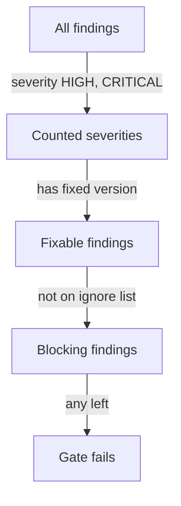

# Severity Filters, Unfixed Findings And Exit Codes

A real image can have hundreds of findings. A pipeline that fails on all of them stops every release, and a pipeline that fails on none gates nothing. A gate is a written rule: which findings count, and what happens when one is found. This part builds that rule from three Trivy options and applies it to the saved report.

## Severity filter, unfixed filter and exit code

The `--severity` flag keeps only the listed severities, for example `--severity HIGH,CRITICAL`. The `--ignore-unfixed` flag drops findings that have no fixed version. A team cannot fix such a finding by updating a package, so it blocks the release without giving the team an action. The finding stays visible in a full report, and the team tracks it separately.

The `--exit-code` flag sets the exit code that Trivy returns when it finds something after the filters. The default is `0`, so by default a scan never fails a pipeline step. With `--exit-code 1` the command exits with `1` when a matching finding remains. Trivy also exits with a non-zero code when the scan itself fails, so a team that must tell the two cases apart picks a different number for findings, for example `--exit-code 10`.



The diagram shows the order of the filters. A finding blocks the release only if it passes every step.

## The gate on your machine

<!-- astrona:playground:renew -->

This command scans an image and fails only for HIGH or CRITICAL findings that have a fix:

```sh
trivy image --severity HIGH,CRITICAL --ignore-unfixed --exit-code 1 docker.io/library/busybox:1.37.0
echo "exit code: $?"
```

Read the exit code, not the table. A pipeline step succeeds on `0` and fails on any other value. The result today can differ from the result next month, because the database changes.

## The same rule on the saved report

Select the playground cluster:

```sh
export KUBECONFIG="$(astrona kubeconfig ats-035-playground-040-02)"
test "$(kubectl config current-context)" = "kind-astro-ats-035-playground-040-02" || exit 1
```

Save this as `count-blocking.py`. It applies the same three filters to the saved report and prints the identifiers it would block on. This script does not read the ignore list yet, so it ignores exceptions:

```python
import json
import subprocess

output = subprocess.run(
    ['kubectl', '-n', 'starfleet', 'get', 'configmap', 'scan-results', '-o', 'jsonpath={.data.results\\.json}'],
    check=True, text=True, capture_output=True, timeout=30,
).stdout
report = json.loads(output)
for target in report['Results']:
    for finding in target['Vulnerabilities']:
        if finding['Severity'] not in ('HIGH', 'CRITICAL'):
            continue
        if not finding['FixedVersion']:
            print('unfixed ', finding['VulnerabilityID'])
        else:
            print('blocking', finding['VulnerabilityID'])
```

Run it:

```sh
python3 count-blocking.py
```

Four lines appear. `FIXTURE-0001`, `FIXTURE-0002` and `FIXTURE-0005` print as `blocking`, because they are HIGH or CRITICAL and have a fixed version. `FIXTURE-0003` prints as `unfixed`, because it has no fixed version. `FIXTURE-0004` is not listed, because its severity is LOW. The ignore list waives `FIXTURE-0005`, as shown after this step.

The rule is now explicit: severity first, then fixability, then exceptions. What remains is how to record an exception so that it does not become a permanent hole, and how much to trust the result.

## Common pitfalls

> [!WARNING]
> - **Leaving the exit code at its default.** Without `--exit-code`, the step always succeeds.
> - **Dropping unfixed findings and forgetting them.** Track them in a separate report so that a fix is applied when it appears.
> - **Filtering by severity only.** The severity comes from the database, not from your workload, so it can overstate or understate your risk.
> - **Mixing scan errors and findings.** Use a distinct exit code for findings when the pipeline must tell them apart.
