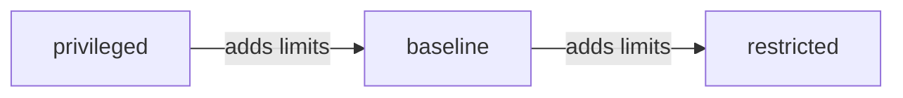

# The Pod Security Standards

A pod can ask for almost anything on a node: the host network, the host file system, every Linux capability. Most applications need none of these. The Pod Security Standards (PSS) are three fixed lists of what a pod may ask for, from no limits to strict limits. This part describes the three levels and shows how a pod that is accepted at one level fails at the next.

## Three levels

- **privileged** has no restrictions. It is meant for system and infrastructure workloads that need host access.
- **baseline** blocks the known paths to privilege escalation and still works for most applications. It forbids privileged containers, `hostNetwork`, `hostPID`, `hostIPC`, `hostPath` volumes and host ports. It limits added capabilities to a short list, and it forbids the `Unconfined` seccomp profile.
- **restricted** follows current hardening practice. It includes everything in baseline and adds more. A container must set `allowPrivilegeEscalation: false`, must drop all capabilities (it may add back only `NET_BIND_SERVICE`), and the pod must run as a non-root user and set a seccomp profile of `RuntimeDefault` or `Localhost`. Only a short list of volume types is allowed: `configMap`, `csi`, `downwardAPI`, `emptyDir`, `ephemeral`, `persistentVolumeClaim`, `projected` and `secret`.



The diagram shows that each level contains the limits of the one before it. A pod that passes `restricted` also passes `baseline`.

## What PSA checks

PSA checks the pod specification only: the fields under `spec` of the pod, including its containers. It does not look inside the image. It does not scan for vulnerabilities, it does not check resource limits, and it does not require a read-only root file system. The `readOnlyRootFilesystem` setting is good practice, but it is not part of any standard.

## Try the levels in the playground

<!-- astrona:playground:renew -->

Select the playground cluster:

```sh
export KUBECONFIG="$(astrona kubeconfig ats-035-playground-040-03)"
test "$(kubectl config current-context)" = "kind-astro-ats-035-playground-040-03" || exit 1
```

The namespace `hangar` has no PSA labels, so a privileged pod is accepted there. Save this as `namespace-trial.yaml`:

```yaml
apiVersion: v1
kind: Namespace
metadata:
  name: trial
  labels:
    pod-security.kubernetes.io/enforce: baseline
```

Apply it:

```sh
kubectl apply -f namespace-trial.yaml
```

Save this as `pod-plain-reader.yaml`. It sets no security settings at all:

```yaml
apiVersion: v1
kind: Pod
metadata:
  name: plain-reader
  namespace: trial
spec:
  containers:
  - name: reader
    image: docker.io/library/busybox:1.37.0
    command: ["sh", "-c", "sleep 3600"]
```

Apply it, then check the pod:

```sh
kubectl apply -f pod-plain-reader.yaml
kubectl -n trial get pod plain-reader
```

The pod is accepted, because a pod with no special settings meets `baseline`. Now preview the same pod against `restricted` without changing anything:

```sh
kubectl label --dry-run=server --overwrite namespace trial pod-security.kubernetes.io/enforce=restricted
```

The command prints a warning that names the existing pod `plain-reader` and lists the fields that break `restricted`: `allowPrivilegeEscalation`, `capabilities`, `runAsNonRoot` and `seccompProfile`. Nothing changes, because of `--dry-run=server`.

You now know the three levels and that the same pod can pass one and fail another. The next question is how a namespace selects a level, in which mode, and for which version of the standard.

## Common pitfalls

> [!WARNING]
> - **Assuming PSA checks images.** It checks only the pod specification.
> - **Expecting `readOnlyRootFilesystem` to be required.** No standard requires it.
> - **Treating `baseline` as hardened.** It blocks known escalation paths, but it allows root and does not require a seccomp profile.
