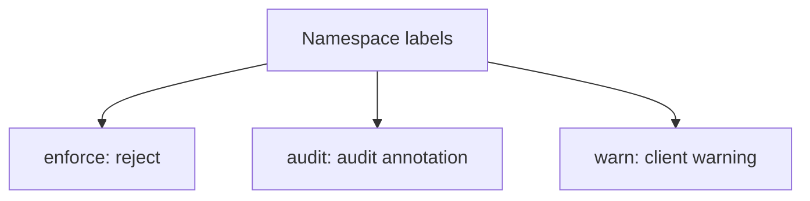

# Namespace Labels, Modes And Versions

A standard is only useful when it is attached to something. PSA attaches it to a namespace with labels, so the owner of a namespace can raise the level without changing the cluster. A label also chooses what happens on a violation, and which version of the standard applies. This part explains the labels and applies them with a rollout that does not break running workloads.

## Three modes

Each label key has the form `pod-security.kubernetes.io/<mode>` and a value of `privileged`, `baseline` or `restricted`:

- `enforce` rejects a pod that violates the standard. The API server returns an error and does not create the pod.
- `audit` allows the pod and adds an annotation to the audit log event.
- `warn` allows the pod and returns a warning to the client that sent the request.

A namespace can use all three modes at once, with different levels. A common rollout sets `warn` and `audit` to `restricted` first, reads the warnings and audit records, fixes the workloads, and then sets `enforce` to `restricted`.

## Versions

The label `pod-security.kubernetes.io/<mode>-version` pins the mode to the standard as defined in a Kubernetes minor version, for example `v1.35`. The value `latest` follows the version of the API server. Without a version label, the mode uses `latest`. A pinned version keeps the check stable after a cluster upgrade; `latest` can start to reject pods after an upgrade if the standard gained a rule.



The diagram shows that one namespace can carry the three modes independently.

## Existing pods and workload resources

Changing a label does not remove running pods. PSA checks a pod when it is created or updated, so a pod that already runs keeps running after `enforce` is raised. The next restart, rescheduling or rollout then creates a new pod that is checked.

For a Deployment, Job or StatefulSet, `audit` and `warn` also check the pod template inside the resource, so the warning appears when you apply the Deployment. `enforce` applies to the pod, not to the Deployment. The Deployment is accepted, and the ReplicaSet then fails to create pods. The reason appears in the events of the ReplicaSet. The Deployment shows fewer ready pods than expected, so check the events when a rollout stalls in an enforcing namespace.

## Label a namespace

<!-- astrona:playground:renew -->

Select the playground cluster:

```sh
export KUBECONFIG="$(astrona kubeconfig ats-035-playground-040-03)"
test "$(kubectl config current-context)" = "kind-astro-ats-035-playground-040-03" || exit 1
```

Preview the effect of `enforce=restricted` on the existing namespace `starfleet`. The `probe` pods and the `shuttle` pod do not meet `restricted`:

```sh
kubectl label --dry-run=server --overwrite namespace starfleet pod-security.kubernetes.io/enforce=restricted
```

The output is a warning for each pod that would violate the standard, with the fields that fail. Because of `--dry-run=server`, the label is not set. This is the safe way to find out what a stricter level would break.

Set the warning and audit modes on `hangar` and read the labels. Using `warn` first does not reject anything:

```sh
kubectl label --overwrite namespace hangar pod-security.kubernetes.io/warn=restricted pod-security.kubernetes.io/audit=restricted
kubectl get namespace hangar --show-labels
```

The task in this module asks you to finish the rollout in `hangar`: enforce `restricted` at version `v1.35`, run one compliant pod and show that an unrestricted pod is rejected.

You can now choose a mode and a version and preview a change before you make it. What remains is how to write a pod that meets `restricted` and what PSA leaves to other controls.

## Common pitfalls

> [!WARNING]
> - **Starting with `enforce`.** Preview with `--dry-run=server` and use `warn` first, so a rollout does not stall.
> - **Expecting running pods to stop.** PSA checks creation and update only.
> - **Leaving the version at `latest` in production.** An upgrade can change the result. Pin the version and update it on purpose.
> - **Setting only `warn` or `audit` and calling the namespace protected.** Only `enforce` rejects a pod.
