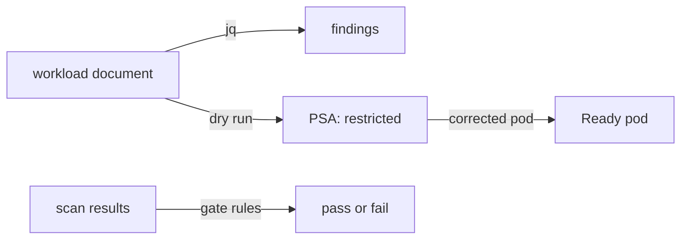

---
exam_objectives:
- Perform static analysis of user workloads and container images (e.g. Kubesec, KubeLinter)
---
# Release A Workload Through Analysis, A Scan Gate And Restricted Admission

Each control in a release checks a different thing. Static analysis reads the workload document before it reaches the cluster. A scan gate decides from the vulnerability findings of the image. Pod Security Admission (PSA) in the API server rejects a pod that breaks the standard of its namespace, even when someone skips the first two steps. This part runs all three on one workload in one namespace, so you can see what each step catches and what it misses.



The diagram shows the order: the findings and the gate decision come from files, and only the corrected pod reaches the namespace that enforces `restricted`.

## Analyse the workload document

Static analysis means that you read the settings of an object without running it. The document below describes a pod that a team wants to release. It is JSON, so `jq`, a command-line JSON processor, can read it directly.

<!-- astrona:playground:renew -->

Select the playground cluster:

```sh
export KUBECONFIG="$(astrona kubeconfig ats-035-playground-040-03)"
test "$(kubectl config current-context)" = "kind-astro-ats-035-playground-040-03" || exit 1
```

Save this as `pod-unsafe-reader.json`:

```json
{
  "apiVersion": "v1",
  "kind": "Pod",
  "metadata": {
    "name": "unsafe-reader",
    "namespace": "release"
  },
  "spec": {
    "containers": [
      {
        "name": "reader",
        "image": "docker.io/library/busybox:latest",
        "command": ["sh", "-c", "sleep 3600"],
        "securityContext": {
          "privileged": true
        }
      }
    ]
  }
}
```

Print the image and the two `securityContext` objects. The pod-level object applies to every container, and the container-level object overrides it:

```sh
jq -c '{image: .spec.containers[0].image, pod: .spec.securityContext, container: .spec.containers[0].securityContext}' pod-unsafe-reader.json
```

The output is `{"image":"docker.io/library/busybox:latest","pod":null,"container":{"privileged":true}}`. That one line holds four findings. The container sets `privileged: true`, which gives it almost every power of the node. The pod-level `securityContext` is `null`, so `runAsNonRoot` is missing. The container does not set `allowPrivilegeEscalation`, so that setting is missing too. The image uses the tag `latest`, which can point to new content at any time. This command prints the tag on its own:

```sh
jq -r '.spec.containers[0].image | split(":") | last' pod-unsafe-reader.json
```

The command prints `latest`. A release review records the tag as a finding, because a digest or a fixed version tag is needed to know what runs.

## Decide the scan gate

A scan gate is a rule that turns vulnerability findings into a release decision. A common rule counts only `HIGH` and `CRITICAL` findings, skips a finding that has no fixed version yet (an unfixed finding), and skips a finding that the team has waived in an ignore file. Every other counted finding blocks the release. Trivy, a vulnerability scanner, writes its findings in the format below, and an ignore file lists one vulnerability ID on each line.

Save this as `scan-results.json`:

```json
{
  "ArtifactName": "docker.io/library/busybox:latest",
  "Results": [
    {
      "Target": "busybox",
      "Vulnerabilities": [
        {"VulnerabilityID": "EXAMPLE-0001", "Severity": "CRITICAL", "FixedVersion": "1.37.1"},
        {"VulnerabilityID": "EXAMPLE-0002", "Severity": "HIGH", "FixedVersion": ""},
        {"VulnerabilityID": "EXAMPLE-0003", "Severity": "HIGH", "FixedVersion": "1.37.1"},
        {"VulnerabilityID": "EXAMPLE-0004", "Severity": "MEDIUM", "FixedVersion": "1.37.1"}
      ]
    }
  ]
}
```

Save this as `trivyignore.txt`:

```text
EXAMPLE-0003
```

The IDs are examples, not real vulnerabilities. Apply the rule with `jq`. The `--rawfile` option reads the ignore file as one string, and the filter splits it into a list:

```sh
jq -r --rawfile ignore trivyignore.txt '
  ($ignore | split("\n") | map(select(. != ""))) as $waived
  | [.Results[].Vulnerabilities[]
     | select(.Severity == "HIGH" or .Severity == "CRITICAL")
     | select(.FixedVersion != "")
     | select(.VulnerabilityID as $id | $waived | index($id) | not)
     | .VulnerabilityID]
  | if length > 0 then "fail: " + join(",") else "pass" end' scan-results.json
```

The command prints `fail: EXAMPLE-0001`. `EXAMPLE-0004` is only `MEDIUM`, `EXAMPLE-0002` has no fixed version, and `EXAMPLE-0003` is waived, so only the fixed `CRITICAL` finding blocks. The gate stops a release in a pipeline, but it does not stop a person who applies the pod by hand.

## Let admission enforce the standard

PSA closes that gap. The `pod-security.kubernetes.io/enforce` label on a namespace tells the API server to reject every new pod that breaks the named standard. The `warn` and `audit` labels add a warning for the client and an entry in the audit log.

Save this as `namespace-release.yaml`:

```yaml
apiVersion: v1
kind: Namespace
metadata:
  name: release
  labels:
    pod-security.kubernetes.io/enforce: restricted
    pod-security.kubernetes.io/enforce-version: v1.35
    pod-security.kubernetes.io/warn: restricted
    pod-security.kubernetes.io/audit: restricted
```

Apply it:

```sh
kubectl apply -f namespace-release.yaml
```

Then send the unsafe document to the API server as a server-side dry run. The API server runs admission, including PSA, but stores nothing:

```sh
kubectl apply --dry-run=server -f pod-unsafe-reader.json
```

The command fails. The error says that the pod `unsafe-reader` is forbidden and `violates PodSecurity "restricted:v1.35"`, and it lists the broken rules, starting with `privileged`. PSA found the same problems as the analysis, but it does not check the image tag, and it knows nothing about vulnerabilities. Each control covers a part that the others miss.

Now give the pod the settings that `restricted` needs. Save this as `pod-corrected-reader.yaml`:

```yaml
apiVersion: v1
kind: Pod
metadata:
  name: corrected-reader
  namespace: release
spec:
  restartPolicy: Never
  securityContext:
    runAsNonRoot: true
    runAsUser: 1000
    runAsGroup: 1000
    seccompProfile:
      type: RuntimeDefault
  containers:
  - name: reader
    image: docker.io/library/busybox:1.37.0
    command:
    - sh
    - -c
    - sleep 3600
    securityContext:
      allowPrivilegeEscalation: false
      capabilities:
        drop:
        - ALL
```

Apply it:

```sh
kubectl apply -f pod-corrected-reader.yaml
```

Then check the result:

```sh
kubectl -n release wait --for=condition=Ready pod/corrected-reader --timeout=180s
```

The command prints `pod/corrected-reader condition met`. The corrected pod uses a fixed tag, runs as user 1000, drops all capabilities and uses the `RuntimeDefault` seccomp profile, so PSA admits it.

You can now take one workload through three controls in order: record the findings of the document, decide the gate from the scan results and the ignore file, and let PSA enforce `restricted` in the namespace. The open question is what happens to pods that already run: PSA checks only new pods, so a namespace label does not remove a pod that was created before it.

## Common pitfalls

> [!WARNING]
> - **Trusting the gate alone.** A pipeline gate does not stop `kubectl apply` by hand. Enforce the standard in the namespace as well.
> - **Trusting PSA alone.** PSA does not check the image tag or vulnerabilities. Keep the analysis and the scan gate.
> - **Counting an unfixed finding as blocking.** The rule here skips findings without a fixed version. Record them separately so that someone checks them again.
> - **Forgetting `enforce-version`.** Without it, the namespace follows the newest standard of the API server, and an upgrade can change what is rejected.
